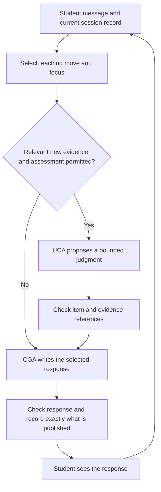

# Improving EdBot's teaching instructions: a design guide for undergraduate researchers

Date: 2026-10-18. Status: **proposal for investigation; no production changes or new experiments performed.**

Audience: a research undergraduate who knows basic programming and wants to understand how tutoring instructions, agent responsibilities, and evaluation fit together. Read this alongside the [CS35L evaluation](../../cs35l-tutoring-evaluation.md). The [earlier alternatives document](2026-10-18-tutoring-quality-alternatives-design.md) contains the broader architectural analysis and historical experiments.

Reading route: sections 1–3 explain the teaching problem; sections 4–6 connect it to the agents; section 7 contains the candidate instruction changes; sections 8–10 show how to investigate them. The researcher exercises are discussion prompts, not tasks the tutor should impose on every learner.

## 1. The proposed change

Keep EdBot's three existing roles, but give them clearer teaching responsibilities and a reliable record of the interaction. The tutor should know **what the learner is trying to do, what help has already been supplied, which question was actually shown, and what the learner has demonstrated**. It should use those facts to choose a useful next move.

Start with focused instruction revisions, then test a small application-owned record and reviewed assessment criteria. Do not start by adding another critic agent to every reply. A critic costs time and can repeat the generator's mistake.

The pedagogical goal is that students can eventually explain, check, and adapt an idea with less help. A fluent answer from EdBot is useful only if it serves the current learning goal. The immediate engineering goal is narrower: fewer false explanations and judgments, better preservation of the student's reasoning work, and more appropriate responses to confusion and stopping.

Preserve the project owner's choices:

- Give concise explanations when requested. Use Socratic guidance for practice and hints: one attainable question that leaves meaningful work for the learner.
- Keep open-ended conversation and accept valid alternative approaches.
- Preserve a selected no-answer agreement, while providing a real route out of inaccessible questioning.
- Leave control/experimental study assignment handling unchanged. A help preference is separate from a research condition.
- Retain useful performance improvements and keep future implementation changes focused.

This is an educator-facing design, so it includes candidate instructions and illustrative replies. Invoking AI Tutor here does not turn this document into a question-only tutoring session. Its strict contract informs the selected Socratic branch; Pedagogical Advisor informs the wider choice between explanation, practice, feedback, and prerequisite support. The combined design is an **original proposal**, not a validated teaching method.

## 2. A few distinctions that prevent many mistakes

| Term | Meaning in this project | Example |
| --- | --- | --- |
| Target capability | Something the learner should be able to do | Choose a test that distinguishes two possible causes of a bug. |
| Learner work | The reasoning the student still needs to perform | Predict the result and explain why it distinguishes those causes. |
| Assistance | Information or cues already supplied | The tutor named the relevant condition or showed a solved example. |
| Evidence | An observable contribution, with its context | The student proposed a test and interpreted its result after one cue. |
| Rubric | Criteria for judging a particular answer | A diagnosis must explain the observed failure under the stated assumptions. |
| Scaffolding and fading | Providing temporary support, then reducing it | Start with a focused trace; later ask for a new diagnosis without that cue. |
| Transfer | Applying an idea when a consequential feature changes | Adapt the reasoning when the contract changes, rather than rename variables. |

Keep three judgments separate:

1. **Correctness:** Is the student's claim true under this task's assumptions?
2. **Completeness:** Did the student supply the parts the task requested?
3. **Evidence of learning:** What can this answer tell us, given the help supplied?

A correct acceptance criterion can be one part of an incomplete assignment. A correct restatement can show that a student followed an explanation without showing independent application. A tentative answer can be correct. These distinctions should appear in the agent instructions and the data the agents exchange.

**Researcher exercise:** Take one reviewed conversation. Write a separate sentence for each of the three judgments. If you need evidence the transcript does not contain, write “not checked.” Notice how much more precise this is than “the student understands.”

## 3. What the existing evidence tells us

The larger evaluation contains 44 synthetic conversation attempts and 111 attempted turns: 110 delivered replies and one application failure. Five of the 30 distinct fixed conversations had a critical finding; two of those concerned private assessment artifacts. These are diagnostic observations, not population error rates or measurements of student learning. One reviewer applied two pedagogical lenses; that is not independent reviewer agreement.

The following cases motivate specific changes. Exact excerpts and technical checks are in the [evaluation report](../../cs35l-tutoring-evaluation.md#illustrative-observations) and [semantic review](../../../output/profiling/cs35l-semantic-review-v1.json).

| Observed problem | Why it matters for learning | Proposed change |
| --- | --- | --- |
| `testing-boundaries`: a requested hint supplied all four boundary classes | The tutor performed the test-selection work the learner wanted to practice | Identify what decision must remain with the learner; inspect cumulative help. |
| `uml-sequence`: the assessor credited tutor-supplied reasoning to the student | Later help may be withdrawn on the basis of an unsupported attainment claim | Record who supplied each relevant idea and assess the contribution in context. |
| `git-index`: a past belief was treated as a current misconception; an unrequested exception became a requirement | A student can receive worse feedback after honestly describing a correction | Distinguish assertion, question, quotation, and retraction; bind grading to the actual task. |
| `user-story-criteria`: a checkable criterion was called untestable because the submission was incomplete | The student is steered away from a valid idea | Separate criterion correctness from missing parts; preserve that judgment in public feedback. |
| `regex-fullmatch`: an unused private rubric contained false acceptance rules | Future correct answers could be misgraded | Check the task and rubric together before relying on either. This was a prospective risk, not an observed student misgrade. |
| `observer-contract`: a valid design was accepted, then undermined by a false comparison | Additional explanation can introduce a misconception after useful feedback | Require support for each consequential claim and keep extra comparisons relevant. |
| `adaptive-project`: related concepts produced incompatible routing obligations and a failed reply | A natural connection between topics became a software error | Separate the current teaching focus from assessment bookkeeping. |

Preserve the positive controls: useful initial React and substitutability hints, acceptance of a proportionate prototype, acknowledgment of a tutor's own Make error, and refusal to certify unseen repaired code. A more restrictive tutor that loses these behaviors is not necessarily better.

## 4. Why adding a longer prompt is unlikely to be enough

Terminology: the **orchestrator** coordinates the conversation; the **content-generating agent (CGA)** writes teaching responses; the **understanding-checking agent (UCA)** estimates what the learner has demonstrated. **Cold start** means the system has little or no prior assessment evidence for a concept. **Bloom tiers** are labels such as Remember, Apply, and Analyze for kinds of cognitive work; this proposal does not treat them as a proven measurement scale of a person's ability.

EdBot already contains many appropriate instructions. The content agent is told to honor explanation requests, avoid answer-bearing hints, change inaccessible support, and accept valid alternatives. Conversation history already reaches the subagents. The observed failures therefore cannot simply be attributed to absent history or a missing “be Socratic” sentence.

Some instructions also pull in different directions:

| Current location | Tension | Proposed resolution |
| --- | --- | --- |
| [UCA: cold-start probing](../../../src/edbot/prompts/uca_prompt.md#cold-start-probing) | Missing evidence is said not to establish recall, but no successful demonstration eventually defaults to `Remember` | Represent “not yet assessed” separately from a provisional task choice. |
| [UCA: answer evaluation](../../../src/edbot/prompts/uca_prompt.md#answer-evaluation) | “Apply the rubric as written” has no adequate invalid-rubric outcome | Check whether grading is warranted; an unresolved rubric defect is not a student error. |
| [UCA: evidence signals](../../../src/edbot/prompts/uca_prompt.md#blooms-taxonomy-tiers) | Vocabulary and confidence are suggested signals, while later rules say not to penalize fluency or tentative phrasing | Evaluate the claim and its reason; treat communication uncertainty separately. |
| [Orchestrator: escalation and routing](../../../src/edbot/prompts/orchestrator_prompt.md#skills-and-decision-procedure) | Clarification triggers reassessment, and a new concept triggers probes even when the learner needs an explanation | Select the requested teaching move first; assess only when relevant new evidence is available and study rules permit. |
| [Current interfaces](../../../src/edbot/interface_def.py) | A question and rubric can arrive as free text without a published item ID; a tier is required | Add versioned item identity and an explicit evidence status before relying on those distinctions. |

These are inspected design tensions, not proof that each caused a particular model error. They generate hypotheses that the experiment should test.

The current optimized runtime also transforms the prompts. [FocusedCGA](../../../src/edbot/middleware/focused_cga_prompt.py) selects mode/tier sections, and [assessment persistence](../../../src/edbot/middleware/assessment_result.py) replaces exact instruction strings when code saves the result. A future prompt revision must inspect the **effective prompt sent to the model**. Editing a Markdown paragraph alone can disable selection or break an exact replacement. Saving a result consistently still does not establish that its educational judgment is true.

## 5. Three approaches worth comparing

| Approach | What changes | Main benefit | Main limitation |
| --- | --- | --- | --- |
| A. Focused instruction revision | Remove conflicts, clarify priorities, add a few contrasting examples | Smallest experiment; tests whether clearer guidance changes behavior | The model still reconstructs task identity and assistance from prose. |
| B. Instructions plus reliable session records | Add published question identity, help history, evidence references, and explicit teaching focus | Makes attribution and routing inspectable; prevents some structural mistakes | Requires interface/state work; correct references can still support a bad inference. |
| C. B plus reviewed assessment material | Add checked task assumptions, criteria, alternatives, and counterexamples for selected concepts | Gives factual and grading judgments an independent basis | Expert authoring and maintenance cost; generated explanations remain fallible. |

**Recommended direction: B, with a small initial portion of C; use A as an experimental comparison.** Start with cases already exposing consequential failures, rather than trying to author all of CS35L at once. Reviewed criteria need not prescribe every sentence or restrict the tutor to a reply bank.

A stronger model or a selective reviewer is a separate comparison. Existing frozen-draft tests found that a same-model reviewer passed three of five known unacceptable drafts and added a median 10.964 seconds per review. That small diagnostic does not establish a general error rate, but it rules out treating reviewer approval as a guarantee. See the [reviewer experiment](../../tutoring-reasoning-evaluation.md#frozen-draft-reviewer-gate-diagnostic).

## 6. Proposed responsibilities and interaction record

The names below describe responsibilities, not a requirement to introduce additional model agents.

| Component | Owns | Must not decide on its own |
| --- | --- | --- |
| Orchestrator | Interpret the request; propose a teaching move and focus | Invent a past question, silently change assistance policy, or turn every clarification into assessment. |
| Content agent (CGA) | Write the selected explanation, question, feedback, or closure | Claim mastery or contradict an accepted assessment without identifying a reason for review. |
| Understanding checker (UCA) | Make a bounded assessment proposal from attributable evidence | Invent missing evidence, grade an unpublished task, or treat a defective rubric as authoritative. |
| Application code | Store IDs and actual messages; validate references, policy transitions, and publication | Infer that a structurally valid judgment is educationally correct. |
| Reviewed course material and criteria | Establish supported premises, alternatives, and checks | Pretend that a related citation supports every added claim. |

“Check response” includes mechanical checks and whatever semantic review has actually been tested. It is not a promise of complete factual or disclosure detection. A simple stop request can use an application-owned acknowledgment without a content-generation or assessment call. That shortcut is a proposed future change.

The minimal proposed record contains:

- **Teaching agreement:** current goal, explanation/practice preference, whether a strict no-answer agreement applies, its source, requested language/format, and a stop/pause state. Student preferences cannot override a trusted course restriction or research assignment.
- **Active item:** stable ID, exact question shown, versioned private criteria when available, stated assumptions, concept tags, and publication status. A generated but unshown question is not active.
- **Delivered help:** references to actual tutor messages and a fallible summary of which ideas or cues they supplied. Do not record only the help the agent intended to give.
- **Learner evidence:** message ID, relevant quotation, related item or concept, and whether it is an assertion, answer, question, quotation, or retraction. Semantic labels remain revisable.
- **Assessment proposal:** criterion-level findings, completeness, help received, evidence status, uncertainty, and references to supporting turns. No new evidence means no new attainment claim.

These are proposed fields, not fields already accepted by the schemas. Keep task-relevant notes minimal; do not add personality diagnoses, motivation scores, or wider student profiling. Existing stored assessments retain their historical meaning. Evaluate new records in **shadow mode** first: record them for comparison without using them to change tutoring or replace current student-model values.

## 7. Candidate instruction changes and how to reason about them

The blocks below are proposed replacements for relevant rules, not append-only additions and not a complete production prompt. Some depend on the new fields above. Mark those dependencies before testing; do not insert instructions that demand information the agent cannot receive.

### Change 1: select the teaching purpose before selecting an assessment

**Candidate orchestrator instruction:**

> Identify whether this turn asks for an explanation, practice, a hint, feedback on an attempt, prerequisite support, clarification, or a pause. Use the actual request and current teaching agreement. Do not require a diagnostic answer before a requested explanation. An unfamiliar concept, a clarification request, or low confidence alone is not new evidence of attainment. Invoke assessment only when the study policy permits it and there is relevant evidence to interpret. A stop request ends instruction without a new probe.

**Why:** Asking “what is an index?” can express a need for instruction. It need not be an attempted answer worth grading. Separate the decision about what help to give from the decision about whether to update an estimate.

**Assistance transitions:** A one-turn request for a hint is not necessarily a permanent strict contract. Record that distinction. In ordinary explanation mode, an explicit request for a worked example may be honored within course policy. Under a selected strict no-answer agreement, deadline pressure does not silently end it. If a later request genuinely makes the intended mode unclear, clarify briefly through the application's policy; do not advertise a route around course restrictions. Record any permitted increase in help so subsequent assessment remains honest.

**Test:** Pair “explain this term simply” with “help me reason it out without giving the definition.” The first should receive instruction; the second should receive an attainable question or a verified learning-resource handoff. Both should honor a subsequent stop.

**Research question:** Could a routing change reduce unnecessary calls while improving help? Measure complete-turn latency and usefulness; fewer calls alone do not show better teaching. The assessment-trigger change also changes the experimental treatment, so test it in a separate evaluation condition rather than silently altering an ongoing study.

### Change 2: grade the contribution, then qualify the learning inference

**Candidate UCA instruction:**

> Judge the claim under the actual task assumptions. Separately report correctness, missing requested parts, and the evidence of learning. Refer to the learner's exact contribution and the help supplied for that item. A correct restatement after explanation is supported performance; it is not an independent demonstration. Tentative wording does not make a true claim partially correct. A past belief described as corrected is not automatically a current misconception. If the intended meaning is unclear, mark the uncertainty rather than inventing a belief. With no relevant new evidence, preserve the prior and record no update; do not infer recall from missing evidence.

**Illustrative replacement:** After the tutor explains a UML ordering rule and the learner repeats it, record: “Correct restatement after the tutor supplied this distinction; independent application has not been checked.” If the learner is still practicing, offer an optional new, unsolved situation requiring application. If they are finished, close. Do not make an extra check a toll for receiving acknowledgment.

**Structural dependency:** `UCAOutput.tier` currently cannot represent no estimate. A future schema should separate an evidence status such as `not_checked`, `insufficient`, `supported`, or `conflicting` from an optional estimate and an instructional starting point. These are proposed categories, not a validated scale. The persistence middleware also saves every valid result and refreshes its assessment turn/count; a true no-update outcome requires a persistence change, not just an optional tier. Keep a record that an evaluation was attempted without presenting it as new attainment evidence. Do not encode “unknown” as `Remember` or silently reinterpret old records. Using Bloom categories to describe the thinking a task requires need not imply a single measured ladder of student ability.

**Test:** Use matched contributions that differ only in speaker history, tentative wording, or retraction. Include new reasoning after earlier help: the system must not label every later answer as copied. Agreement, gratitude, and failure to answer an optional probe should not become attainment evidence.

### Change 3: assess the question the student actually received

**Candidate orchestrator/UCA instruction:**

> For an answer submission, reference the published item and its applicable criteria. Do not reconstruct or expand the question to fit the student's reply. If no matching published item exists, interpret the message as ordinary conversational evidence or request clarification; do not fabricate a formal grading task. Before grading, check whether the premises and criteria are sufficient and consistent. An unresolved task or rubric defect makes the judgment unavailable, not the student incorrect.

**Why:** In `git-index`, the grading task introduced requirements beyond the plain-commit scenario. “Grade more carefully” does not prevent this if the grader receives an invented task as authoritative input.

**Structural dependency:** Code should bind item ID, exact published text, criteria version, and response references. It can reject a nonexistent or unpublished item. It cannot prove a criterion is sound. A short conversational probe may provide useful evidence without a formal rubric; do not invent one after seeing the answer and call it a predeclared assessment.

The current answer-judgment schema allows only correct, partially correct, or incorrect, and persistence requires a judgment whenever an answer submission exists. An explicit “item cannot yet be graded” result therefore needs coordinated schema, validation, persistence, and feedback changes. Omitting the judgment would currently fail validation. This requirement belongs in P2, not the instruction-only P1 experiment below.

**Rubric repair rule:** Preserve the original record. Flag the defect, obtain a reviewed correction, and create a new version. Reconsider affected judgments transparently if necessary. Do not quietly change the grading standard after seeing an inconvenient answer.

**Test:** Supply a valid unusual solution, an under-specified task, contradictory scoring bands, and a conversational question mistaken for an answer. The system should distinguish these cases rather than force all of them into correct/partial/incorrect.

### Change 4: preserve accurate feedback when turning assessment into a reply

**Candidate CGA feedback instruction:**

> Acknowledge the specific valid contribution. Distinguish a wrong idea from an incomplete response or a requested formatting change. Address one consequential gap when further work is wanted. Preserve the accepted criterion-level judgment; if you find a substantive conflict, flag it for resolution before publishing incompatible feedback. Do not manufacture a misconception to justify a next question.

**Illustrative replacement for `user-story-criteria`:** “That criterion is checkable: it states what should happen when a second person tries to book the same room and time. You have supplied one of the requested criteria.” If practice continues, ask for one remaining part. If the student asked only whether this criterion is testable, stop after answering that question.

**Why:** Feedback can invite revision without falsely rejecting correct work. The content agent needs the bounded findings necessary to give consistent feedback, not a broad hidden profile or the UCA's entire rationale. Today it is instructed to receive only the resolved tier; a structured feedback payload would be an interface change.

**Test:** A reply must neither claim an incomplete exercise is complete nor call a valid criterion untestable. Include correct alternative designs and terse or multilingual answers. Judge the reasoning, not resemblance to the reference wording.

### Change 5: make a hint preserve work, and change support when it does not help

**Candidate CGA instruction for selected Socratic practice:**

> Use the student's actual attempt to identify one attainable next act of prediction, checking, comparison, explanation, or revision. Before sending a hint, identify what consequential decision remains for the learner after all help so far. Do not reveal that decision in a statement, leading question, answer-containing menu, solved analogy, tool output, or sequence of hints. When sound reasoning is present, acknowledge it and allow closure. If the question is inaccessible, change the support instead of rephrasing the same demand.

**Illustrative replacement for the boundary-test case:** If the learner has shown a condition and can trace it, ask: “Choose one input where you suspect this condition disagrees with the requirement. What do you predict?” This leaves test selection to the learner. It is too broad for a learner who cannot yet read the condition; for that learner, narrow to an accessible prerequisite instead. A question is not good merely because it withholds the answer.

Use a revisable diagnosis, based on the contribution:

| Evidence of difficulty | Next move | What to observe |
| --- | --- | --- |
| A term or operation is unfamiliar | In explanation mode, explain the prerequisite plainly. In strict mode, point to a specific verified introductory passage or human help. | Can the learner interpret a small new example after that opportunity? |
| The learner understands the task but cannot choose a check | Ask one discriminating question grounded in the attempt, within the agreed help level | Does the learner produce and interpret useful evidence? |
| Several concepts or requests overwhelm the learner | Reduce to one relation; use their preferred format | Can they make progress without first solving a bundle of subproblems? |
| The learner succeeds with a cue | Acknowledge the bounded success; offer a new case with less cueing when appropriate | Can they apply the idea without the previous prompt? |
| The learner asks to pause or stop | Brief closure | No new exercise, forced reflection, or inference of mastery. |

Two unsuccessful attempts at the same idea can be a practical reminder to change support; it is not a scientific quota or a requirement to struggle twice. Escalate earlier when prerequisites are absent. In strict mode, neither a new file nor a “similar” solved example is a legitimate way to disclose the target solution. If the mode cannot provide the needed instruction, say so and offer a verified resource, TA, pause, or change of target.

**Test:** Review the entire exchange, not question marks or word counts. Include missing prerequisites, requests for a smaller step, deadline pressure, a correct explained answer, and a stop. Count both over-helping and unproductive withholding.

### Change 6: check the premise of the teaching move

**Candidate shared content/assessment instruction:**

> Separate task assumptions, student claims, source-supported facts, and unverified inferences. Check the factual premise of a question or correction before steering the learner with it. Use a source only for claims it supports under the relevant language, version, and contract. If evidence is inadequate or contradictory, state the narrow uncertainty and withhold the unsupported verdict. If you made an error, withdraw it explicitly. Avoid extra comparisons that introduce new unsupported claims.

**Why:** The Observer reply began with useful acceptance and then introduced a false account of cancellation. The regex exercise had a plausible question and an incorrect private key. Both require checking meaning, not merely attaching a source.

**Proposed course support:** For a small set of assessment tasks, keep reviewed assumptions, acceptable alternatives, counterexamples, criteria, and source versions together. A concrete execution can disprove a universal claim, but passing several examples does not prove a complete rubric. Review conceptual claims separately. A retrieved course passage can itself be incomplete or conflict with authoritative language documentation; flag the conflict for course review rather than silently changing scope. Any future use of outside references by EdBot is an explicit grounding-policy change, not a tool it already has.

**Test:** Require the reviewer to identify the particular claim supported by each check. Include valid alternatives and a misleading related passage. For an unresolved rubric, evaluate whether the system avoids a definite grade while still offering useful, appropriately qualified help.

## 8. A small interaction worked through as a design example

This is a proposed interaction, not output from an experiment. Its purpose is to show how the responsibilities cooperate.

1. **Student:** “I want a hint for choosing a test, not the full test list.” The orchestrator selects practice with bounded help. The active item records the actual condition and stated requirement; no understanding update follows merely from asking.
2. **Tutor:** Asks for one input and predicted behavior, provided the transcript indicates that this is attainable. The application records the exact question and actual cue.
3. **Student:** Gives an input, predicts a result, and explains the mismatch. The UCA checks that contribution against the original requirement. It records which reasoning the learner supplied and what cue preceded it.
4. **Tutor:** Acknowledges the verified reasoning. It does not list all remaining tests or claim the whole program is repaired. If the learner wants continued practice, it can ask one relevant next question.
5. **Student:** “That's enough for now.” The tutor closes. A missing independent follow-up stays “not checked.”

Now change step 3 to “I don't know what the condition means.” The correct next move is prerequisite support under the selected mode, not a lower ability label followed by the same question. Change it to a new question about a related concept: preserve the original item, select the new teaching focus, and avoid converting a side question into an answer submission.

For the cross-topic failure, the application must represent pending assessment work separately from the response it owes the student. One explanation may connect concepts, while assessment evidence remains scoped. Define how each pending obligation is resolved, deferred, or cancelled. On incompatible generated routing, allow a bounded correction and then a clear recovery response; do not remove the guard and silently lose track of work. A saved assessment and a delivered explanation are separate events.

## 9. How an undergraduate can test these ideas

### Step 1: audit the evaluation material before treating it as an answer key

Use the existing conversations for regression checks, and reserve new scenarios for testing generalization. Keep student wording natural: incomplete context, a plausible mistake, a tentative answer, a challenge to the tutor, and a request to stop. Stress should come from realistic learning interactions.

The frozen `prerequisite-resource` case contains a stale `reference_facts` line prohibiting the target definition, while its actual student request and revised expectations explicitly permit a simple explanation. The historical report used the contextual interpretation. **Do not rewrite the historical fixture or silently treat every metadata sentence as correct.** Create a new version with an explicit correction log and instructor-reviewed expectations for future comparisons. This is a useful example of why the evaluator also needs scrutiny.

### Step 2: compare changes that answer different research questions

| Condition | Change from the previous condition | Question it addresses |
| --- | --- | --- |
| P0 | Frozen current deployment | What happens under the current system? |
| P1 | Focused instruction revisions that fit the current interfaces | Do clearer priorities and contrasting examples improve behavior without new state? |
| P2 | P1 plus item/help/evidence records actively supplied to agents, with necessary interface support | Does reliable interaction context add value beyond the instructions? |
| P3 | P2 plus reviewed criteria for selected topics | Does an independent assessment reference reduce technical and grading errors? |

P1 cannot honestly implement unavailable fields such as an explicit no-estimate output. Record those requirements as unimplemented; keep its scope limited to the changes the current interfaces support. P2 is a package of related changes. A P2 improvement does not identify which component caused it; use a later **ablation**, meaning removing one component at a time, for that question.

Before active P2, run a shadow-record check: compare the proposed records against the actual conversation without changing agent inputs or decisions. This checks record fidelity only. It cannot establish a tutoring benefit. Active P2 is a separate synthetic evaluation in which the agents consume those records and the new result-handling rules take effect; it still does not change the deployed study.

Freeze prompts, model/version, generation settings, retrieval snapshot, effective prompts, and server configuration. Freeze the candidate before held-out evaluation; cases used to revise it become development cases. Keep research assignment handling fixed; use isolated synthetic student stores. The current runtime context supplies a student ID but no verified trusted condition assignment, so production control-condition exclusion remains unverified. Separate isolated routing tests with a trusted condition supplied by the test harness from a claim that the deployed study gate works. Do not infer assignment from student text or introduce a new default. Resolve and verify that independent assignment issue before a learner-facing controlled study; this document does not change it.

Replay the 30 distinct fixed conversations and preserve the six repeat anchors. Multiple fresh runs per condition, for example three as a planning starting point, help expose variability; this number is not a statistically justified sample size. Evaluate episode trajectories, not each turn as an independent observation. For reactive conversations, use common starting situations and explicit rules for plausible follow-ups, but adapt to the actual response. Do not pretend divergent adaptive transcripts are identical paired inputs.

When a fixed student follow-up no longer plausibly fits the preceding tutor response, flag that mismatch and distinguish it from a tutor error. Report held-out results separately from development and regression cases. An identical script does not automatically make two conversations equally realistic or their scores directly comparable.

### Step 3: predeclare separate outcome measures

| Measure | Review unit and denominator | What it can establish |
| --- | --- | --- |
| Technical accuracy | Delivered replies containing checkable disciplinary claims; report critical claims separately | Accuracy in the reviewed sample. |
| Preservation of learner work | Turns under a selected bounded-help agreement, inspected with prior help | Whether the tutor supplied the target reasoning. |
| Useful next step | Instructional turns, considering prerequisites and the actual learner contribution | Whether an attainable, relevant action remains. |
| Assessment validity | Assessment outputs, split into public feedback and private records | Correct task binding, criteria, attribution, and qualification. |
| Help and closure fit | Requests for explanation, changed support, pause, or stop | Whether the system respects the request without adding unnecessary work. |
| Operational cost | All attempted turns, including failures; successful latency also reported separately | Completion, calls, tokens, median and tail delay, and review overhead. |

Report numerator, denominator, and uncertainty. Report invalid-item detection alongside answer accuracy so a system cannot appear excellent simply by declining all difficult judgments. A new critical factual or disclosure failure should trigger investigation even if an average score improves. Distinguish incorrect student feedback from an unused defective rubric.

Have a course expert check technical references and criteria. Where feasible, use two reviewers blinded to condition, retain disagreements, and adjudicate with evidence. Report agreement separately from accuracy: reviewers can agree on the same mistake. Use AI reviews to help locate cases, not as a substitute for independent subject judgment.

Run latency comparisons under matched concurrency, warm-up, and workload conditions. The earlier quality cohorts overlapped on the Spark, so their timings are not a matched performance baseline. An extra reviewer or longer prompt must justify its cost through measured behavior; saving time is valuable if students can use it for learning.

### Step 4: test learning only after behavior is adequate

Synthetic conversations can show that an agent follows instructions or makes an error. They cannot show that a real student learns. For a later instructor-supervised pilot, specify the target capability, comparator, task time, access arrangements, and outcome before collecting data.

Measure assisted task performance separately from an immediate independent application. Add a delayed task if claiming retention, and a task with a meaningful changed demand if claiming transfer. Preserve accommodations when removing the AI assistance under evaluation. Record missing outcomes, help received, student burden, and instructor correction time. Do not choose a participant count by convenience and call the study confirmatory; discuss a feasible design and power or precision target with the research supervisor.

**Researcher exercise:** Suppose P2 produces fewer false mastery claims but no improvement in independent performance. What did it improve? What did it fail to establish? Suppose it improves accuracy by refusing most questions. Which denominator reveals that tradeoff?

## 10. A practical first milestone

Before implementing a broad redesign, prepare three reviewed case packets: boundary-test hints, the Git belief-revision case, and the user-story criterion. Each packet should include the student goal, exact dialogue, current failure, candidate replacement instruction, an acceptable reply, a plausible unacceptable reply, a positive control, and a check that could disconfirm the proposed benefit. Add the regex rubric as a separate item-validity case.

Then test the narrow P1 changes. Keep the architectural requirements visible rather than claiming prompt improvements implement them. Next validate published item IDs and assistance/evidence references in shadow mode, then test active P2 with those records supplied to agents. Pilot C through P3 on the few tasks needing stronger technical judgment. Revisit broader Bloom-based adaptation and cold-start policy as explicit study-design decisions.

For each proposed instruction, the undergraduate should be able to answer:

1. What learner action is this intended to preserve or enable?
2. What observed failure motivates it, and what is still only a hypothesis?
3. What information must the agent receive for the instruction to be usable?
4. What valid situation would a too-strict version mishandle?
5. What observation would persuade us to keep, revise, or reject it?

Those answers are the research contribution. A longer prompt or a higher simulated pass count, by itself, is not.

## 11. Evidence and reading notes

**Project evidence inspected:** the current prompts, interfaces, prompt-selection and assessment-persistence middleware, the cross-concept guard, the earlier alternatives document, the CS35L report, and compact evaluation records. The checkout was `1183f4f` when this guide was written. Earlier behavior was measured with the implementation identified in the evaluation report; no new model runs were conducted for this guide. Complete raw captures remain local as documented there.

**Pedagogical resources used:** [Pedagogical Advisor 2.2.0](/Users/tobiasduerschmid/.codex/skills/pedagogical-advisor/SKILL.md), especially its AI support/pilot procedure and quality gates; and [AI Tutor](/Users/tobiasduerschmid/.codex/skills/ai-tutor/SKILL.md), especially its response contract, evidence/design rationale, and evaluation rubric. These links refer to the author's local skill installation. The operative recommendations are explained above so a reader does not need that installation. Neither skill is empirical validation of this combined design.

Two primary research sources provide context, not a forecast for EdBot:

- **Bastani et al. (2025), PNAS**, [published article](https://pmc.ncbi.nlm.nih.gov/articles/PMC12232635/), “Experimental Design” and “Main Results,” especially Table 1. The inspected main text describes a randomized field experiment with nearly 1,000 high-school mathematics students in one Turkish school. Standard GPT assistance improved assisted practice but reduced subsequent unassisted exam performance relative to control. The safeguarded tutor largely mitigated that reduction without demonstrating a positive exam effect over control. Its hints and teacher-provided problem information were bundled, so this does not isolate a question-only rule or establish an undergraduate computing effect. Design implication: assess independent outcomes and examine help content. The [published correction](https://pmc.ncbi.nlm.nih.gov/articles/PMC12403119/) concerns an author affiliation.
- **Kestin et al. (2025), Scientific Reports**, [published abstract](https://pubmed.ncbi.nlm.nih.gov/40537565/), DOI `10.1038/s41598-025-97652-6`. The abstract reports a randomized comparison of a designed AI tutor with active classroom learning and reports higher learning outcomes in less time for that tutor. Access for this guide was limited to the abstract because full-text retrieval was unreliable; no sample-size or delayed-outcome claim is made here. This is a reminder to compare particular instructional designs and outcomes, rather than assume AI help is uniformly beneficial or harmful.

Access checked 2026-10-18. This is a focused design guide, not a systematic literature review. Recommendations about EdBot's records, candidate prompt wording, priorities, and experiment sequence are original design judgments to test.
