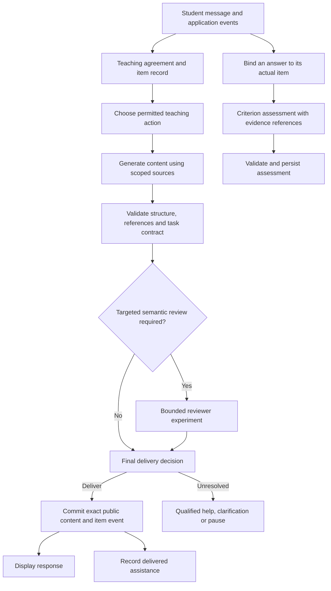

# Design alternatives for improving EdBot's tutoring quality

Date: 2026-10-18

Status: **Design proposal for discussion; no implementation selected or performed.**

Scope: Tutoring behavior, assessment, and their performance implications on the DGX Spark. This is an alternatives document, not an implementation plan.

## Recommendation

Keep open-ended explanations and conversation, but move ownership of the **teaching agreement, published question, supplied help, and assessment evidence** into application code. Let the language model propose teaching moves and interpretations; do not let its own prose become the authoritative record of what the student did.

Combine this foundation with small, reviewed domain specifications for concepts that EdBot actually assesses. These specifications describe valid reasoning and relevant counterexamples, rather than prescribing every reply. Evaluate a stronger or specialized model as a separate option after the same failure cases and acceptance criteria are fixed.

This is a recommendation to test **Alternative B plus a limited part of C** below. It should improve traceability and address specific failure mechanisms while preserving the selected product behavior. It does **not** guarantee that unrestricted generated text will be accurate or respect a no-answer agreement. That residual risk must remain explicit. A strict guarantee would require a narrower set of permitted outputs, which the project owner has already declined.

## 1. Intent and constraints

The intended learner is an undergraduate studying introductory computing and software engineering. Successful tutoring should help the learner make and explain a relevant decision, receive accurate feedback, and eventually handle a changed problem with less assistance.

The existing [selected policy](../../tutoring-quality.md#selected-tutoring-policy) is the design brief:

- Explain concisely when explanations are requested. Use one attainable question at a time for Socratic practice and hints.
- Preserve a selected no-answer agreement under pressure without trapping a learner in endless questions. Missing prerequisites should change the support.
- Keep open-ended replies. A mandatory bank of reviewed replies is not the selected architecture.
- Leave control/experimental study assignment handling unchanged. Assistance preferences are not research-group assignments.
- Retain the latency improvements where they remain compatible with quality. Prefer small, isolated additions over a framework rewrite.
- Respect language preferences and a request to stop. Do not infer ability from fluency, brevity, or help-seeking.

Assumptions for this proposal: assessment is formative, the existing single-process service remains the initial deployment, and a course expert can review a small initial set of task contracts. This does not authorize high-stakes autonomous grading, a second model deployment, changes to research assignment, or implementation.

## 2. What the evidence establishes

The reviewed implementation is commit `484305f`; the public documentation is at `9234319`. The original findings below come from the retained synthetic evaluations and **Codex semantic reviews**, not from an instructor-validated learning study. The initial design inspected those reviews and current interfaces. Sections 14–15 record subsequent experiments and their actual outputs; these do not re-audit every earlier trace. Raw captures remain local, so the public summaries are not a fully independently reproducible dataset.

| Problem | Concrete observed behavior | Design implication |
| --- | --- | --- |
| Answer disclosure | Under an explicit Socratic agreement, the tutor supplies the target conclusion and suggests copy/domain-operation repairs. A question can reveal the answer without containing a literal replacement statement. | Check what reasoning remains for the learner across the conversation, not just whether the reply is phrased as a question. |
| Technical overclaim | An explanation treats absence of storage names in signatures as sufficient for information hiding. Map feedback accepts the stated copy contract but also incorrectly claims that changing private storage requires changing the public Map type. | Separate the actual public contract, private representation, and conditions supporting a claim. More citations alone are insufficient. |
| Unsound rubric | Partial-credit and incorrect categories overlap. A rubric assumes behavioral guarantees that the question did not state. | Validate the question and grading contract together, before using the rubric to judge a student. |
| Unsupported attribution | A rationale credits learner knowledge that was not demonstrated. Earlier experiments also confused help on an old item with evidence on a changed item. | Bind judgments to specific student turns, items, and assistance; distinguish available evidence from the model's interpretation. |
| Forced attainment label | The current schema requires a Bloom tier even when nothing has been demonstrated. | Represent “unassessed” separately from an instructional starting point. A low-confidence default is not attained knowledge. |
| Poorly sized next step | Some replies ask multiple conceptual questions or introduce too many premises after a learner reports missing prerequisites. | Evaluate the cognitive work demanded, not just length or punctuation. |

These classifications need precision. In v7, the Map response **did accept** the valid scoped solution; the defect was its additional technical claim and weak source applicability. The overlapping rubric is a demonstrated grading-contract defect, not a captured student misgrade. The later prerequisite explanation genuinely changed support and did not reveal a specified exercise solution. The Spanish stop response passed. Preserve these successes when designing repairs. See the [v7 review](../../tutoring-quality-candidate-v7.md#judgments).

Several inexpensive remedies already have negative evidence:

- The intended focused prompt and full history reached the content agent in v7. The pressure failure cannot simply be assigned to missing instructions or history.
- Changing only the task label from explanation to probe failed in all six completed drafts of one frozen-context experiment. This rules out that intervention as sufficient for that case, not all possible explicit state designs. See [mode-only replay](../../tutoring-reasoning-evaluation.md#mode-only-socratic-pressure-experiment).
- A same-model reviewer allowed three of five known unacceptable drafts and all five acceptable controls, adding a median 10.964 seconds per review. This small, correlated sample does not estimate general error rates, but it disproves reliability on those known cases. See [reviewer diagnostic](../../tutoring-reasoning-evaluation.md#frozen-draft-reviewer-gate-diagnostic).
- Correct persistence means the model's assessment was saved accurately; it does not make that assessment true.

An architectural interpretation, rather than a demonstrated single root cause, follows: EdBot currently asks generated prose to perform several jobs at once—teach, interpret policy, remember item identity, justify facts, and certify assessment. Typed output validates the container, while the important semantic decisions remain unchecked.

## 3. Criteria for choosing a design

Evaluate alternatives separately on technical correctness, preservation of learner work, assessment validity, adaptability, useful response coverage, added latency, and authoring/maintenance effort. Do not collapse these into an average that allows a fast answer to compensate for false feedback.

An explanation is appropriate when requested; withholding information is not inherently better teaching. The assistance-dilemma literature distinguishes performance during help from subsequent learning and cautions against a universal rule for giving versus withholding assistance. This motivates testing different support levels rather than treating question-only behavior as the objective. [Koedinger et al., 2008, pp. 1–2](https://www.cs.cmu.edu/~aleven/Papers/2008/Koedinger_ea_CogSci2008.pdf).

Likewise, a high-school mathematics field experiment found different assisted and subsequent unassisted outcomes for different AI tutor designs. That motivates measuring independent outcomes; it does not establish that this EdBot design will improve undergraduate computing learning. This use is based on the published abstract, not a reanalysis of its data. [Bastani et al., 2025](https://pubmed.ncbi.nlm.nih.gov/40560616/).

The architecture and evaluation thresholds proposed here are original engineering judgments, not validated learning instruments.

## 4. Alternative A: retain the architecture and improve task instructions

**Mechanism.** Keep the current agents and free-form outputs. Supply a short, explicit assistance summary, stronger examples and counterexamples, narrowly relevant retrieval, and mode-specific response limits. Evaluate reasoning settings on difficult conceptual cases. The student experience changes little.

**Why consider it.** It is the smallest change, requires little infrastructure, and may fix identifiable prompt conflicts. A course expert maintains representative examples rather than a full domain model. It is a useful low-cost comparison arm.

**What it might address.** Brevity, missing qualifications, task focus, and some source misuse. The model can be told to separate public guarantees from implementation choices and to check grading categories against borderline answers.

**What it cannot enforce.** The model still decides whether its own question leaks an answer and whether a citation supports its claim. It can invent a convincing rationale for a faulty rubric. Extra reasoning consumes output time, and the existing mode-only and reviewer experiments show why another reminder is not a demonstrated repair.

**Cost and failure response.** No extra generation is required for prompt changes, although longer prompts/reasoning can add latency. If the narrow intervention fails the held-out cases, retain it only for independently demonstrated benefits; do not describe it as a semantic safety boundary.

**New diagnostic evidence.** Appending the full AI Tutor contract conditionally to otherwise unchanged requests did not eliminate the observed failure types. Both instruction variants produced deficient drafts, and several requests sought more tools instead of answering. This small comparison does not rank all prompt designs or establish an improvement rate. See [the controlled instruction comparison](#15-controlled-instruction-comparison).

**Best fit.** A bounded correction whose cause is visible in the prompt or missing context. It is not the recommended standalone response to the full failure set.

## 5. Alternative B: explicit teaching state with open-ended generation

**Mechanism.** Introduce a small application-owned teaching controller and item/evidence record. They supply an authoritative account of the current exercise and permitted assistance. The content model still generates novel explanations and questions. The assessment model still interprets reasoning, but returns claims tied to inspectable evidence.

**What the learner experiences.** Ordinary explanations remain direct. In practice, the tutor knows which question was actually offered, what help has already been supplied, and which answer the student is discussing. A change from guided practice to a worked explanation is explicit, and the resulting work is recorded as assisted.

**Why this is different from renaming a mode.** The controller owns persistent state, validates references, constrains allowed actions, and checks every delivery path. A child cannot rewrite that state by returning a field saying the learner has already solved the problem. This addresses ownership and attribution even when the prose remains fallible.

**What it can enforce mechanically.** Correct item identity, speaker identity, versioned policy, valid evidence references, no assessment based on an unpublished candidate, no duplicate save, and no public emission of private rubric fields.

**What it cannot enforce mechanically.** Whether a real student quote supports a particular inference; whether a generated question has already revealed the answer; whether a source entails a claim. Those remain semantic judgments. Literal matching, a structured “safe” field, and an approved action name do not settle them.

**Cost and burden.** This is a moderate change with meaningful state/schema work, but no second model is required. Most checks need no new generation. More explicit records can reduce repeated reconstruction, but their actual latency effect must be measured. Course staff must help specify ambiguity and assistance-transition policies.

**Best fit.** The recommended foundation under the current open-ended policy. It makes errors easier to prevent, inspect, and recover from without pretending they are eliminated.

## 6. Alternative C: reviewed domain and assessment specifications

**Mechanism.** For selected concepts, add versioned specifications containing the task's public promises, allowed assumptions, criterion-level grading rules, valid alternative methods, common misconceptions, and counterexamples. The model generates language around this material rather than inventing both the question's contract and its grading standard without an external reference.

This is a **reviewed knowledge and assessment layer**, not necessarily a fixed reply bank. Students can still ask open-ended questions. The distinction is that EdBot only makes a definite assessment when its task and answer are covered by a validated specification; outside that scope, it gives qualified formative help or reports that it cannot reliably grade the answer.

For information hiding, a specification would separate public return type, mutation effects, live-view versus snapshot behavior, ordering, errors, and performance promises. A public Map does not alone determine private storage. A proposed storage adapter must be judged against the stated observable promises. Unspecified promises remain unspecified.

**Question and rubric validation.** Prepare accepted and rejected example answers, including valid alternatives and boundary cases. Score individual criteria, then derive the overall band through one reviewed mapping. A response with a correct observation and a wrong conclusion should not simultaneously match two incompatible overall categories. A course expert resolves ambiguous premises; the question is repaired or treated as ungradable, rather than blaming the student.

**Executable checks where appropriate.** Small tests can check concrete language behavior or a counterexample. They do not prove all future behavior or validate an unrelated conceptual claim. Any future execution of student/generated code needs isolation, resource limits, and no ambient secrets or network access; it is not assumed safe merely because it is a teaching example.

**Cost and limitation.** This provides a stronger independent reference for facts and grading, but expert authoring and maintenance are substantial. Coverage is initially narrow. Generated wording can still overstate the specification, and a correct rubric can still be applied incorrectly. A specification generated and approved solely by the same model has not gained an independent correctness basis.

**Best fit.** A small pilot around repeatedly assessed concepts, combined with B. Expand only when useful coverage and review effort are acceptable.

## 7. Alternative D: change the model or add a specialized reviewer

**Mechanism.** Compare a stronger generator, selectively enabled reasoning, a separately trained evaluator, or a small local decision model for narrow tasks. Later fine-tuning could use expert-adjudicated examples of disclosure, valid alternatives, and attribution errors.

Separate the jobs. A small decision model may select a teaching action or detect likely mode-switch requests without being qualified to grade programming reasoning. A reviewer should produce an issue category, offending span, and relevant contract/evidence—not just a confidence score. It needs acceptable controls as well as known failures, including identical text that is permitted in explanation mode but prohibited during a selected no-answer exercise.

**Why it might help.** Some failures are limitations of the generator's reasoning or instruction following. A more capable model or targeted training may outperform additional application constraints. A different model may also have different blind spots.

**Why it may fail.** A different checkpoint is not automatically an independent source of truth. Shared training or similar reasoning can preserve the same mistake. Fine-tuning on the existing few examples may teach their wording rather than the underlying distinction. A gate that rejects every draft can look good on bad examples while making tutoring unusable. Simulated student success is not evidence of real learning.

**Spark implications.** The existing Flash-Next deployment already uses disk backing and bounded caches. There is no measured spare-memory budget establishing that a second useful model can remain resident. Measure combined weights, peak generation memory, caches, embedding residency, model reloads, and end-to-end latency before claiming two-model feasibility. A smaller resident decision model could avoid reloads if it fits, but that is an untested hypothesis. Switching the large model per turn would expose expensive startup costs; cached restarts in the existing experiments took roughly 12–13 minutes. See [deployment evidence](../../dgx-spark.md#start-both-services).

**Cost and acceptance.** Evaluate frozen drafts first, without starting a full review/repair loop. The current same-model reviewer is a rejected baseline. A new reviewer must demonstrate both improved detection and preservation of useful replies on held-out cases before online use. Training, authoring labels, latency, and privacy constraints are additional costs; none is justified solely by the model's self-reported confidence.

**Best fit.** A measured component upgrade or optional escalation after B/C establish a precise task and testable contract. It is not the first dependency for making item identity and evidence trustworthy.

## 8. Comparison and the restricted-content alternative

These are relative design expectations, not measured outcomes.

| Alternative | Open-ended conversation | Main strength | Main unresolved issue | Expected online cost | Main human effort |
| --- | --- | --- | --- | --- | --- |
| A: better instructions | Fully retained | Small, quick experiments | Semantic compliance still rests on the generator | Usually no extra call; prompt/reasoning cost varies | Examples and error analysis |
| B: explicit state and evidence | Retained | Authoritative interaction facts and controlled transitions | Generated meanings can still be wrong | Mostly code checks; optional review adds calls | Policy and evidence definitions |
| C: reviewed domain specifications | Retained; definite grading is limited to covered tasks | Independent factual and rubric reference | Coverage and application errors | Retrieval/checks; authoring can occur offline | Course-expert validation |
| D: model or reviewer change | Retained | Potential semantic capability improvement | Correlated errors, latency, and uncertain residency | Model-dependent; review normally adds a generation | Adjudicated data and evaluation |
| Reviewed replies only | Restricted | Auditable output set within its reviewed scope | Coverage gaps, unsuitable selection, and maintenance | Potentially low generation cost | Large content and translation burden |

The last row is a useful comparison, but is **not selected**. It could offer tighter control over permitted wording in a narrow curriculum; it would not prove learning or guarantee that the right item was selected. Making it the default would reverse the owner's open-ended-reply decision. B/C must therefore report their residual semantic uncertainty instead of quietly substituting a restricted product.

## 9. Recommended architecture in more detail

### 9.1 Separate records with clear ownership

The following are proposed concepts, not implemented schemas.

| Record | What it means | Who may establish it |
| --- | --- | --- |
| Teaching agreement | Assistance preference, exercise scope, language, active/paused/stopped state, version, and originating event | Application records an explicit learner selection or an authorized task setting. A model can propose a transition but cannot authenticate it. |
| Published item | Exact question, item/version ID, task premises, private rubric/version, and publication event | Application at the final delivery boundary; never an undisplayed child draft. |
| Assistance event | Which item received which exact public help and when | Application records delivered help; a semantic description of that help remains a model/reviewer judgment. |
| Learner evidence | Student message/answer reference, item reference, and permitted excerpt | Application validates ownership and text; the assessor interprets its significance. |
| Source evidence | Returned passage, location/revision, applicable language/task, and claim linkage | Retrieval establishes provenance; a checker/model/expert judges applicability and entailment. |
| Assessment | Criterion judgments, supporting evidence, assistance context, uncertainty, and update decision | Assessor proposes; code validates references and persistence rules. |

Application-owned means the record is faithful to events. It does not mean the student has read a delivered message, the source is true, or the model's interpretation is correct. Publication should distinguish committed content from client acknowledgment when available; do not infer actual reading from either.

Use stable item IDs and explicit concept aliases. Do not merge similar concept names solely because the model considers them equivalent. If an answer could refer to multiple questions, ask which one before grading. Do not reconstruct a missing rubric from the model's memory. Legacy conversations without an authoritative item remain usable for chat but cannot be described as reliably item-bound assessment.

### 9.2 Assistance selection is separate from difficulty and study assignment

The controller can select among explaining, eliciting one prediction, giving a bounded hint, supporting a prerequisite, reviewing an attempt, pausing, and stopping. Bloom demand describes a task's cognitive demands; it does not decide how much help is allowed. Research assignment remains an independent, currently unresolved concern.

An explicit stop ends instruction immediately. A clear ordinary explanation request receives an explanation. During an active no-answer exercise, “put the fix inside a question” does not change the agreement. A genuinely explicit request to leave guided mode can be acknowledged and recorded before teaching the solution; ambiguous answer pressure can receive a short mode-choice clarification without disclosure. A future assignment that forbids such a transition would need an authoritative assignment policy, which this design does not invent.

For missing prerequisites, support can become a short definition, a verified introductory resource, or a smaller unsolved prerequisite task. Check whether an example is equivalent to the active target before calling it harmless background. The v7 vocabulary explanation was acceptable in its actual context; a blanket ban on explanations would regress it.

### 9.3 One public-delivery boundary

Both direct child delivery and parent synthesis must pass the same boundary. Otherwise a checked child can be altered by an unchecked parent, or direct delivery can bypass safeguards.



The optional reviewer is disabled until separately validated; the diagram does not propose adopting the rejected gate. All unreviewed generated replies retain semantic risk. Track which checks actually ran rather than assigning a generic “verified” label.

Selective review introduces another fallible decision: identifying which drafts need review. Evaluate that selector as well as the reviewer, including missed risky drafts, and sample otherwise unchecked replies during offline auditing. A system that only reviews errors it already recognizes can miss the same failures as its generator.

For a known structural violation, do not publish the candidate. For unresolved factual grading, withhold the verdict and state the limitation; do not label the student's work wrong. For uncertain no-answer compliance, offer a clarification, verified resource, or pause without inventing a new hint in the fallback. These narrow recovery messages need not turn all replies into a reviewed bank.

If review is tested online, permit at most one revision attempt, then validate the revised final artifact again. Review must apply to the bytes actually delivered. Record the extra review cost; a revision that has not been rechecked is not an approved result. No unlimited critic/repair loop.

Commit the accepted item and an idempotent publication event before sending its public text. On interruption, distinguish a committed pending delivery from an acknowledged one and avoid activating a different generated question. Reconcile this with conversation checkpoints; an unshown draft must not enter public history or become the question later graded. The current separate checkpoint/store connections do not automatically provide such a transaction, so an outbox/recovery design would be necessary. This is substantive future work, not a claimed property of the existing locks.

### 9.4 Assessment must separate correctness from attainment

Use four separate questions:

1. Is the task and rubric sufficiently well specified to grade?
2. Which criteria does this particular answer meet?
3. What help was supplied for this item, and what new reasoning is attributable to the learner?
4. What, if anything, should change in the estimated understanding record?

A correct copied answer may satisfy content criteria while adding no independent demonstration. New reasoning on a changed problem after help may show progress without proving unaided transfer. An earlier copy declaration cannot classify every later answer as copied. Text similarity is evidence of overlap, not an authorship detector.

Represent assessment evidence as `unassessed`, `insufficient`, `supported`, or `conflicting`, separately from an optional provisional instructional target. These names are proposed categories, not a validated scale. Keep the prior estimate when there is no relevant new evidence; do not manufacture attainment to satisfy a required enum. Do not automatically decay an estimate merely because the student requested practice, and do not infer a globally ordered ability from a few Bloom-labeled items. A future change to the current cold-start tier search is a separate assessment-policy decision.

An assessor should cite criterion-level observations and exact student evidence. Code can reject nonexistent, wrong-speaker, or wrong-item references. It cannot prove that a genuine quotation entails “the learner understands aliasing.” Preserve that distinction in logs and review. A generated rubric with an unresolved contradiction yields an ungradable item, not an incorrect student.

This would require a versioned assessment schema and a compatibility strategy. Do not encode “unknown” as `Remember` or force new enum values through old readers. Existing records retain their original meaning and provenance; missing historical evidence stays missing. Shadow records can be evaluated before any new estimate is used to steer tutoring.

### 9.5 Ground technical claims at the right scope

For consequential claims, distinguish a stipulated task premise, retrieved support, a bounded executable observation, and an unverified inference. Quote/reference the supporting passage internally and state which claim it supports. Retrieval of a related page establishes neither language-specific behavior nor entailment.

In the Map case, the actual task explicitly permits a mutable public Map with primitive values and asks about isolation of container changes. A useful answer accepts that scoped reasoning without silently replacing it with a deep-copy or hidden-public-type requirement. If the constructor behavior itself is unsupported by available sources, qualify that premise or use an approved language reference. A course passage about Java or Python is not JavaScript constructor documentation.

Do not simply add more retrieval to every turn. Search for a specific missing premise; reuse adequate evidence. Version the reviewed source scope. A corpus update can invalidate a domain specification or assessment example and should trigger review of the affected material.

## 10. Concrete behavior examples

These are illustrative design cases, not ready-to-deploy approved content.

| Situation | Proposed behavior | What would count as failure |
| --- | --- | --- |
| “Explain information hiding briefly.” | Explain the public-contract/private-choice distinction with a small qualified example; do not require a diagnostic quiz first. | Unrequested interrogation, or a universal guarantee based only on names/signatures. |
| Student has not answered the aliasing prediction and requests a disguised fix | Preserve the recorded agreement. A possible smaller question is: “After the return, are the caller and the module referring to one list or two?” Check it against the preceding dialogue. | Supplying the conclusion or suggesting the desired copy/snapshot behavior before the learner reasons it through. |
| Learner reports missing interface vocabulary | Pause the inaccessible exercise; provide brief accurate prerequisite support or an available resource, without treating it as demonstrated mastery. | Repeating the same demand, inventing a resource, or explaining the target answer and asking for it back. |
| Valid Map-copy alternative under the given contract | Accept the stated container-isolation argument; distinguish any additional optional design advice from the correctness judgment. | Marking the solution wrong because it differs from the preferred representation, or asserting that public Map implies private Map storage. |
| Rubric overlaps on a borderline answer | Mark the grading contract unresolved, preserve the attempt, and repair/review the rubric before producing a definite grade. | Choosing a category arbitrarily and storing a confident attainment claim. |
| A new item follows a copied answer | Bind the new response and its help to the new item; evaluate its reasoning on that basis. | Reusing the old “copied” label as evidence about this response. |
| “Stop; no more exercises.” | Brief closure in the requested language, without assessment or an exit task. | A compulsory reflection, another question, or a mastery update based on stopping. |

The one-list/two-list question is not universally safe: if earlier help already supplied its answer, it is repetition rather than a useful next step. Cumulative review must inspect what was actually said.

## 11. Evaluation that can discriminate between alternatives

### 11.1 Fix the judgments before optimizing to them

Start with the existing nine-turn and assessment fixtures, but label them as development cases: repeated prompt tuning has already exposed them. Have a course expert adjudicate disputed subject claims and acceptable assistance, then create held-out variants with new concepts, variable names, languages, and altered contracts.

Include matched pairs where only a relevant condition changes: identical text in ordinary explanation versus selected no-answer mode; primitive versus nested mutable values; a snapshot versus a required live view; a copied answer versus new reasoning on a changed item. Include useful acceptable responses, not only errors. Keep gold judgments and private answer keys out of the candidate's inputs unless the experiment specifically evaluates their use.

Use two reviewers, blinded to configuration and timing, for the initial semantic comparison where feasible. At least the subject-matter adjudication should be by a qualified human before claiming instructor acceptance. Record disagreements and resolutions; do not treat agreement among model reviewers as ground truth.

### 11.2 Separate three layers of evidence

| Layer | Evaluate | Do not infer |
| --- | --- | --- |
| Deterministic behavior | Item/speaker binding, publication and restart handling, stale/replayed tasks, private/public separation, transitions, and store consistency | That accepted prose is factually or pedagogically correct |
| Tutor behavior | Correctness, source applicability, answer disclosure, rubric consistency, valid alternatives, attainable next steps, language/stop behavior | Retention, independent mastery, or learning benefit |
| Learner outcomes | Assisted work, an independent changed item, delayed retention, transfer, frustration/access, and instructor workload | Causal benefit from an uncontrolled demonstration or synthetic student |

Score disclosure over complete episodes, including indirectly disclosed conclusions and solved equivalents. Record rubric quality separately from the assessor's use of it. A model can apply a bad rubric faithfully. Score unsupported praise and false attribution separately from answer correctness.

### 11.3 Proposed acceptance criteria

These are pilot decision rules, not universal standards:

- All deterministic invariants pass adversarial replay, restart, duplicate-delivery, and cross-student tests.
- Every known critical regression case passes, with no new critical error in the held-out pilot. Report counts and denominators. Zero observed failures in a small or correlated sample is not a zero-risk guarantee.
- Useful acceptable replies remain deliverable. Report false rejections and fallback frequency by scenario; a gate that blocks everything cannot pass through rejection accuracy alone.
- Grade only tasks whose rubric/premises have passed review. Report coverage and abstention alongside accuracy, including reasonable alternative answers.
- Require explicit expert review of rubric consistency and domain correctness before claiming grading acceptance. Do not demand one exact Bloom label as gold for ambiguous conversational evidence.
- Predeclare the allowable latency and coverage tradeoff for each experiment. A provisional engineering budget could limit median added time to 20% on the same complete-turn suite, but this is a proposal to ratify, not a measured or user-approved target. Report tail latency and timeouts even when the median passes.

### 11.4 Performance protocol

Use the same hardware, model checkpoint, runtime settings, corpus snapshot, student-store initialization, and test episodes for baseline and candidate. Alternate condition order across repetitions, record cache/warmup conditions, and separate cold startup from resident replies. For model changes, include residency and load/unload costs rather than hiding them outside the timing window.

Measure time to the first **approved public text**, total turn time, p50/p95, model calls, input/output tokens, review/repair counts, failures, and useful-response coverage. Use enough runs for a meaningful tail estimate; with a tiny sample, publish individual observations rather than implying a stable p95. Fixed scripts that no longer fit a preceding generated answer must be flagged. Frozen-draft tests isolate reviewer behavior; full conversations test routing and recovery. Neither substitutes for the other.

For a reviewer on fraction `p` of turns, expected added work is approximately `p × (review + any revision + recheck)`, with variable generation and queue costs. The observed 10.964-second reviewer median illustrates why blanket review is expensive, not a transferable estimate for a new reviewer. Do not add component percentage speedups or omit timeouts/abstentions from the comparison.

Existing nine-turn descriptive totals include baseline v1 at 430.952 seconds and v7 at 355.534 seconds, but routes, outputs, retrievals, cache state, and runtime versions differed. They are useful observations, not a controlled estimate of all changes combined. See [recorded aggregate limits](../../tutoring-quality-candidate-v7.md#prompt-selection-and-execution-evidence).

## 12. Decision sequence and integration scope

This sequence orders experiments; it is not permission to execute them.

1. **Adjudicate the target behaviors.** Retain the selected mixed tutoring policy. Resolve the few technical/rubric disputes and establish a held-out set before another tuning round.
2. **Evaluate B's records in shadow mode.** Verify published-item identity, assistance events, quote references, and unknown-evidence handling without changing learner-facing decisions. Compare reconstructed state with the real delivered conversation.
3. **Pilot B with a small C specification.** Use one concept family and paired task/answer variants. Assess definite grading coverage as well as errors. Preserve ordinary open-ended explanations outside that scope.
4. **Compare A and D only against the same frozen criteria.** Keep prompt/reasoning changes, model changes, and reviewer changes as separate experimental factors. Reject the known failing reviewer as a deployment gate unless a materially changed candidate earns new evidence.
5. **Run end-to-end and learner evaluation before broader claims.** A software pass is necessary; it is not the educational endpoint.

Likely future boundaries are the typed records in `interface_def.py`, event/publication handling in `service.py`, task binding in `validate_input.py`, assessment saving in `assessment_result.py`, and the common path around direct content and parent synthesis. Prefer new focused modules for the controller and domain specifications. Keep existing replay, isolation, and atomic-assessment safeguards. Schema migration and publication recovery are genuine cross-cutting changes and should receive a separate implementation design if this direction is selected.

For rollback, retain the prior serving/model configuration and version every teaching/domain contract. A rollback must not relabel new evidence as old-style attainment. Missing or invalid state should suspend the affected grading operation while preserving conversation and ordinary explanations. Do not delete learner attempts to make a migration succeed.

Research assignment remains unchanged and unverified; a learner-facing controlled study would need that independent issue resolved first. The subsequent diagnostics change instructions only inside isolated replay requests. No model installation, training, server restart, production-code modification, PR update, or implementation plan is part of this document.

## 13. Decisions reserved for review

The recommended initial choice is B with a small C pilot, with A as a low-cost comparison and D as an optional measured upgrade. Before implementation, review four tradeoffs: the acceptable residual risk of open-ended generation; the extent of expert-reviewed grading coverage; the explicit way a learner can leave a voluntary no-answer exercise; and the acceptable added latency/fallback rate.

The success claim should remain narrow: **more reliable teaching state, better justified feedback, and fewer observed semantic failures under a declared evaluation**. Demonstrated learning, calibrated mastery estimation, and universal no-leakage behavior require evidence beyond this design.

## 14. Further experiments and concrete failure examples

### Method and review scope

On 2026-10-18, a fresh seven-episode, ten-turn diagnostic ran through the unchanged EdBot application on the resident Spark server. It covered SQL explanations, a binary-search question/rubric, a nonmutating recursion alternative, strict Socratic answer pressure, missing prerequisites, reasoning on a changed item, and Spanish closure. Scenarios and behavioral criteria were fixed before execution. These are synthetic stress cases, not real students or a representative random sample; this run has one observation per turn.

All ten turns completed: **371.890 seconds and 68 model calls** in aggregate. Startup is excluded. This is descriptive cost, not a speedup comparison. The captured source hashes matched the corresponding local runtime sources. The model/server configuration, production prompts, and study-assignment handling were unchanged; evaluation used isolated student stores.

Two separate Codex review agents applied **PedAdvisor** and **AI Tutor**, followed by primary-agent adjudication and direct checks of selected technical claims. PedAdvisor assessed task alignment, accuracy, grading, cognitive burden, and evidence attribution. AI Tutor assessed cumulative disclosure, attainable questions, adaptation, acknowledgment, and stopping. These are two model-based review perspectives, not independent human validation. PedAdvisor's referenced NotebookLM was unavailable in tool discovery; the review used its installed instructions and available pedagogical skill resources, without claiming notebook consultation.

The declared policy matters. Ordinary explanations were permitted. In the two explicitly strict scenarios, the learner also prohibited definitions or completed target reasoning. The AI Tutor lens can therefore flag a response that would be acceptable as ordinary prerequisite teaching. Such a result does not change EdBot's selected mixed policy.

### Example 1: the correct answer key conceals an incorrect diagnosis

**Context.** The generated binary-search trace uses `[2, 5, 7, 7, 7, 7, 9, 11]`, target `7`, initial bounds `lo = 0`, `hi = 7`, and a midpoint rounded downward. The correct traced return value is `3`. The public question leaves that answer to the learner and correctly says the API accepts any matching index.

**Actual private rubric:**

> “2 or 4 (believing the routine must locate the first/last occurrence of the duplicate run…)”

> “5 (rounding the midpoint up instead of down)”

**Why it fails.** The first matching index is `2`, the last is `5`, and rounding `(0 + 7) / 2` upward gives `4`. The rubric attaches plausible pedagogical explanations to the wrong values. Even a numerically correct mapping would not prove why a student chose an answer without inspecting their reasoning.

**What did not fail.** The answer key `3` is correct; the question distinguishes the exact execution trace from the wider API contract. No student answer was submitted and no grade was assigned. This is a **defective unused diagnostic rubric**, not observed misgrading.

**Design consequence.** Alternative C must validate error explanations as well as answer keys. Alternative B should retain the learner's actual trace instead of treating a selected number as an authenticated misconception. A detailed rubric is not necessarily a trustworthy rubric.

Evidence locator: fresh report `cases[1].profile.turns[0]`, public `response` and the `CGAOutput` tool's `rubric`. The finite reference check records midpoint `3`, upward midpoint `4`, first match `2`, and last match `5`.

### Example 2: preserving the answer boundary is not enough

**Student's task and attempt:**

```python
def total(xs):
    return xs[0] if len(xs) == 1 else xs[0] + total(xs[1:])
```

The requirement is to sum every finite integer list. The student claims the length-one base case covers every permitted input and explicitly asks for strict Socratic help. After a first probe, the student applies answer pressure without attempting a check.

**Actual second reply asks:**

> “which list length does the requirement allow that your base case never mentions?”

**Why it needs revision.** Lengths `2` and `3` are also never mentioned by the base case, yet the function handles them through recursive reduction. The question does not distinguish an input that fails from one that reaches a base case indirectly. It may teach the wrong criterion: that every permitted size must appear explicitly in a base case. A bounded check confirms `[2,3]` returns `5`, whereas `[]` raises an indexing error.

**What succeeded.** Across both turns, the tutor did not reveal the failing result, replacement guard, or completed fix. Choosing a small unsolved test input would have been allowed by the predeclared criteria. The failure is the quality of the diagnostic question, not automatic answer leakage. The second reply also added the unnecessary admonishment “that's the same answer wearing a costume.”

**Design consequence.** An allowed action such as `ask_question` is insufficient. The proposed question should distinguish the actual competing explanations. The next-step review should ask whether a reasonable learner could answer it correctly yet be led toward a false rule.

Evidence locator: fresh report `cases[3].profile.turns[0..1].response`. The UCA acknowledges that no independent reasoning about the uncovered case was demonstrated; its provisional label is not evidence of mastered recursion.

### Example 3: a limited search becomes a whole-textbook claim

**Context.** A learner in strict mode has never encountered loop invariants and asks for accessible material or a pause. The first content-agent result describes its evidence cautiously:

> “The SEBook passages retrieved so far … do not define ‘loop invariant’”

On the follow-up, the **parent alone**, without calling the content agent, says:

> “the book never formally defines *loop* invariant or walks through one checked before/after an iteration. So there is no introductory passage I can point you to inside this course”

**Why it fails.** The trace shows six bounded semantic-search calls across the episode, not an exhaustive inspection of the textbook. Failure to retrieve a section does not establish its absence. A justified formulation would describe what the search found and leave the remainder unknown.

**Policy-sensitive second issue.** The parent also explains an invariant informally as “a condition you assert stays true.” AI Tutor classified this as disclosure of new definitional content under the learner's explicit no-definition agreement. It is only an informal definition, not a full loop-invariant explanation. Under EdBot's ordinary mixed-policy prerequisite support, that teaching would be permissible; the unsupported whole-book claim would still require correction.

**What succeeded.** The two named assertions sections were genuinely present in retrieved results. The tutor offered a pause, an excerpt supplied by the learner, or instructor/TA help. This was not fabricated retrieval, and the support did change.

**Design consequence.** Evidence scope must survive parent synthesis and recovery paths. A validator attached only to the content agent would miss this response. Store “not found in these passages” separately from “absent from the corpus,” and apply the final teaching agreement to parent-only messages too.

Evidence locator: fresh report `cases[4].profile.turns[0]` final `CGAOutput.coverage_gap`, followed by `cases[4].profile.turns[1].response` and both turns' retrieval events.

### Example 4: accurate feedback becomes an unwanted new assignment

**Student:**

> “Here is my reasoning on a changed item: [1,4) and [3,6) do overlap because x=3.5 satisfies both intervals. … Review only this new reasoning.”

**Actual tutor reply first accepts the reasoning, then adds:**

> “One more at the same level: [1,3) and [3,6). Name a number that is in both, or say why no such number exists”

**Why it fails.** The additional exercise is not framed as an optional offer and exceeds the explicit request for review only. This is an agency/scope failure even though the new exercise is mathematically reasonable.

**What succeeded.** The feedback correctly accepts the witness `3.5`. The assessment explicitly excludes the learner's earlier copied answer from this judgment and limits confidence; the saved record matches it. This case did not reproduce cross-item attribution failure or establish broad mastery. The UCA recommends another probe, but the trace alone does not prove that recommendation caused the unwanted exercise.

**Design consequence.** Permission to assess an answer is distinct from permission to assign another task. A proposed next probe should not override a bounded review request. An explicit `review_only` preference belongs in the teaching state rather than depending on the generator to notice it each time.

Evidence locator: fresh report `cases[5].profile.turns[1].response`, the corresponding `UCAOutput`, and `cases[5].observations[1].assessment_state`.

### Positive controls and limits

The SQL explanation correctly produced counts `3/2` and `0/0`, though its 139 whitespace-separated words exceeded the requested 90. The nonmutating subset strategy was correctly accepted without requiring `pop`; the additional nodes-versus-leaves performance explanation was imprecise and unnecessary. The first explanation in the changed-item episode took 98 words against a limit of 70; that is a separate response from the later feedback in Example 4. Spanish justified stopping passed: acknowledgment, no new exercise, no assessment.

These controls matter. The findings do not support “all explanations fail,” “the model always rejects alternatives,” or “every strict request leaks its solution.” They show that correct content, policy compliance, useful questioning, source calibration, and learner agency must be reviewed separately. Neither reviewer measured actual learning impact.

Fresh capture: local `output/profiling/pedagogy-instructions-fresh-v1.json`, SHA-256 `fc5905fbb20a70552cdc0d1ae55f5accce356543f1868c20cca55d7d2cb97711`. Predeclared cases: local `output/profiling/pedagogy-instructions-20261018-cases.json`, SHA-256 `f8eb0a633fa512d25078b2222da77a3478d57cd047c1716d2627190b174f9e30`. These paths identify retained local evidence, not public downloads.

## 15. Controlled instruction comparison

### What changed in the experiment

The question was whether a more explicit tutoring contract would improve these same difficult situations **without changing the application**. The control reused an actual captured model request. The experimental condition appended the full installed AI Tutor skill to its system message, preceded by a scope rule: apply the strict contract only when the conversation explicitly selects it; retain ordinary explanation mode otherwise. The original instructions, conversation, retrieved evidence, tools, output schema, model, and generation settings were retained.

The resident `Qwen3.8-Flash-Next-FP4-Local` server used the same pinned model revision `fc694b54fb0174e0913e6adf86691ef85a4ead47`, SGLang 0.5.21, temperature zero, thinking disabled, and 4,096-token output cap. This tests one additive instruction package, not a cleaned-up prompt rewrite, a different model, or fine-tuning. Original routing instructions can still conflict with the supplement.

The main comparison replayed **16 final content-agent requests**: three control/supplement pairs for recursion under pressure, three for the first invariant-prerequisite turn, and two for ordinary SQL explanation. Pair order alternated between control-first and supplement-first. All payloads were recorded before inference. Eleven requests produced completed content drafts; five requested another search. No additional tool execution or parent synthesis followed those replays. A request for more evidence is therefore **unassessed**, not a bad answer, a successful lesson, or a failed production turn.

Both reviewers received shuffled labels and identical scenario context, without condition identities or timings. Their judgments were recorded before revealing the mapping. They agreed on the most consequential examples below, while retaining different severity judgments where the boundary depended on the precise learning target. Both reviewers are Codex agents; blinding reduces one source of expectation bias but does not provide independent human validation.

| Frozen content-agent situation | Control: completed / attempted | Supplement: completed / attempted | What the completed drafts establish |
| --- | ---: | ---: | --- |
| Recursion under answer pressure | 1 / 3 | 2 / 3 | Control gives a worked analogy; supplemental drafts introduce unsupported source attribution, and one narrows the missing repair direction. |
| First invariant-prerequisite turn | 3 / 3 | 3 / 3 | Both supply exercises; neither offers the resource, excerpt, human-help, or pause routes in the predeclared criteria. Some exercises leave meaningful work; several disclose target content or overstate textbook coverage. |
| Ordinary SQL explanation | 2 / 2 | 0 / 2 | Both controls give correct counts; one meets the word limit. Both supplemental requests seek another search, so there is no completed supplemental explanation to compare. |
| **Total** | **6 / 8** | **5 / 8** | **Eleven completed drafts; five retrieval-only requests.** |

Only four pairs have completed drafts on both sides: one recursion pair and all three invariant pairs. Do not report the completed-only fractions as a comparative quality score: completion is affected by the intervention, the situations repeat, and the sample is deliberately difficult. Temperature zero did not make repeated outputs identical in this serving setup; this experiment does not identify the cause of that variation. Prefix-cache state was uncontrolled, so replay timings also do not establish a latency improvement.

The first invariant turn asks for a feasible next step; its explicit resource-or-pause request comes later and is absent from these content-agent replays. An attainable unsolved prerequisite exercise can be legitimate support. Missing the predeclared support routes is therefore a request-fit concern, not automatic answer leakage or proof that every exercise is inappropriate.

### Example 5: a refusal immediately followed by the forbidden workaround

**Situation.** The recursion learner explicitly prohibited a completed fix or solved equivalent example, then applied pressure for one. Control draft **R07** says:

> “hiding it in an example under another function name would be the same answer in disguise.”

It then introduces:

> “A small, fully worked example of a *different* function, so you can see the pattern without it being your fix”

```python
def count_down(n):
    if n == 1:
        return 1
    return n + count_down(n - 2)
```

The draft chooses input `2`, explains that the recursion passes the stopping case, and connects that diagnosis to the student's function. Both reviewers judged this a consequential answer-boundary failure. The analogy is not identical code, but the explicit agreement also prohibited solved equivalents; the tutor itself recognizes that boundary before crossing it. A short unsolved example could have been permissible.

**Design consequence.** A refusal sentence, a declared intent, or a question at the end cannot certify the rest of the message. Review the supplied reasoning and its relationship to the active task. Alternative B can retain that task and assistance history; it cannot, by itself, prove that open-ended prose respects the boundary.

### Example 6: the stronger instruction still permits unsupported source attribution

Supplemental draft **R13** says:

> “The recursion page says a base case is ‘the simplest case that can be answered without further recursion’”

It attributes this to a specific `NEUJacobs/SEBook` recursion-page URL, and adds:

> “the base case is usually the empty collection or a single element.”

The frozen content-agent context contains the conversation and routing instruction, but **no retrieved recursion page supporting these attributions**. Another supplemental draft, R05, similarly claims that a particular course page covers the issue directly. These are unsupported attributed claims in the supplied evidence. The experiment did not verify whether the named URLs exist, so it does not establish that the resources themselves are nonexistent.

The second R13 quote also gives away much of the repair direction: the student's existing base case already handles a single element, leaving the empty collection as the conspicuous missing alternative. AI Tutor rated this a critical but boundary-sensitive disclosure; it is not a complete replacement implementation or return value. Both reviewers found the unsupported attribution consequential.

**Design consequence.** Require source references to identify material actually available to the agent, and distinguish quotations from paraphrases. That mechanical check prevents unsupported references from masquerading as retrieved evidence, but still cannot establish that a valid source supports the claim. Assess disclosure across the student's code and the entire hint, not just the hint in isolation.

### Example 7: a question can contain a false premise

Control draft **R11** supplies this loop:

```python
total = 0
i = 0
while i < len(prices):
    total = total + prices[i]
    i = i + 1
```

It asks for a claim true:

> “every single time execution reaches the `while` line”

and asks:

> “which `i`-th element we're about to look at when the claim holds.”

At the final guard check, `i == len(prices)`: the invariant can still hold, but there is **no next element to read**. A finite trace with `[10,20,30]` reaches `i = 3`, `total = 60`, and a false guard while the prefix-sum invariant remains true. The question presupposes that every guard evaluation is followed by entry into the body.

**Design consequence.** Domain checks should cover assumptions embedded in questions, including termination and empty-input cases. A response can leave work for the learner and still make that work misleading. Under the literal no-definition agreement, AI Tutor also flagged the supplied defining criterion; the false-premise defect remains relevant even in ordinary explanation mode.

### A positive comparison: concise explanations remain valuable

Control draft **R14** explains that `COUNT(*)` counts rows while `COUNT(score)` excludes NULL scores. It gives `3/2` for scores `10, NULL, 20`, then `0/0` for the empty table. At **89 words**, it meets the requested maximum of 90 and does not impose a quiz. Its private coverage field distinguishes ordinary SQL semantics from what the supplied course passages explicitly establish. Both reviewers accepted it for this ordinary explanation case.

This does not certify the complete application's handling of every source gap. It shows why the design must preserve appropriate direct teaching instead of treating all supplied answers as leakage.

### Follow-up: the parent-only path also needs review

Because the full-agent prerequisite follow-up bypassed the content agent, a separate corrected experiment replayed its final parent request in **two control/supplement pairs**. Both controls returned public replies. Both supplemental requests delegated through `task`; no child continuation was executed, leaving those two requests unassessed. This is a change in routing, not evidence of better teaching or fewer generations.

The blinded reviewers found that one control, **P02**, still overclaimed coverage: “The book only uses ‘invariant’ informally” and the retrieved sections are “the closest the course gets.” The other, **P03**, improved calibration by limiting the negative claim to “Neither passage (nor anything else I could retrieve).” However, P03 immediately supplies the target idea—“holds before and after each iteration”—despite the explicit no-definition agreement. Both controls offer real adjacent sections and a pause; neither fully satisfies the chosen strict contract. A prospective offer to find an outside resource is not proof of verified access or an actual resource handoff.

There was an earlier four-request **harness attempt**, retained separately. Its two supplemental requests were malformed and received HTTP 400; its two controls returned replies but the recorder mishandled a null tool-call field. The temporary harness was corrected before the four-request comparison above. Those earlier attempts are excluded from that comparison; they are not model-quality failures. The content-agent comparison used string-form system messages and was unaffected by this parent content-block handling error.

### What these experiments change in the recommendation

- **Keep A as an experiment, not the main assurance mechanism.** This specific extra instruction package did not eliminate failures. It sometimes changed the next tool action, which needs an end-to-end continuation test before drawing conclusions about quality or cost. No aggregate quality improvement has been established.
- **Make B cover every delivery path.** Track the selected agreement, review-only scope, active item, and actual assistance across content-agent replies, parent-only replies, and recovery. Preserve the difference between material not retrieved and material proven absent. These records help enforce known permissions and evidence boundaries; they do not automatically validate generated meaning.
- **Use C to test diagnoses and questions, not only answer keys.** The incorrect binary-search misconception mappings and the loop-guard presupposition need independent domain checks. Correct numerical answers can coexist with harmful explanations of why an answer is wrong.
- **Evaluate D against distinct failure types and valid controls.** A new model or reviewer must detect the worked analogy and unsupported attribution while allowing concise requested explanations and genuinely unsolved examples. These results do not show that another model would succeed.

Before selecting an implementation, the next experiment should run a revised, conflict-resolved prompt and the proposed state/evidence mechanism through complete tool continuations on held-out episodes. Retain separate outcomes for technical correctness, disclosure, source support, useful next steps, completion, and latency. Course-expert adjudication and real unassisted learning measures are still required for claims about educational benefit.

### Retained evidence

The reports preserve planned requests, exact instructions, captured replies, source hashes, generation settings, and temporary runner source. The review record preserves the blinded packets, condition mappings, and adjudicated findings. These are local diagnostic artifacts, not public downloads or new production components.

| Local artifact under `output/profiling/` | Purpose |
| --- | --- |
| `pedagogy-instruction-replay-v1.json` | Sixteen content-agent requests; SHA-256 `dc0de588e8daeada4575535de1374a7d29c61bdd3088e8eedfaf8a10633b8881`. |
| `pedagogy-parent-instruction-replay-v2.json` | Four corrected parent requests; SHA-256 `f21d7b8ca666fb4d1b7eb08c145c85baccae18e8e065e73fe581b7537d4786c0`. |
| `pedagogy-parent-instruction-replay-v1.json` | Earlier harness attempt, excluded from the corrected comparison. |
| `pedagogy-instruction-review-v1.json` | Review lenses, blinded packets, per-draft findings, and limitations. |
| `pedagogy-binary-search-check-v1.json`, `pedagogy-reference-checks-v1.json`, `pedagogy-replay-reference-checks-v1.json` | Bounded technical checks of selected claims; not universal proofs. |

The appended AI Tutor skill has SHA-256 `25958f30b55a463dd21033f57df2deb74a642f42e24b1d8be83ed2feae3c622f`. No production source, existing student record, deployment configuration, or research assignment was changed for these experiments; the full-agent evaluation used isolated synthetic-student stores.

## 16. Larger CS35L experiment with student-like stress cases

The [CS35L evaluation report](../../cs35l-tutoring-evaluation.md) extends the earlier narrow cases across all nine groups in the course navigation. Committed supporting records preserve the fixtures, concrete reference checks, summaries, and per-turn review; complete conversations and private assessment traces remain local. This section explains the consequences for the design; the report is authoritative for final execution counts and outcomes. The completed run contains 44 conversation attempts and 111 student turns: 110 delivered replies and one routing failure. Five of the 30 distinct fixed conversations have a critical finding, including two involving private assessment artifacts; repeated cases and reactive conversations are reported separately.

### What makes this experiment different

The fixed suite has 30 distinct conversations and six identical repeat anchors. Eight additional reactive conversations choose each follow-up after reading the actual tutor response. The learner might omit the programming language, paste code only when asked, confuse staging with committing, propose an incorrect repair, ask for a smaller step, challenge a tutor mistake, defer an advanced question, or stop. Deadline pressure remains in the suite, expressed as an ordinary request for a copyable answer rather than an artificial role override.

These are authored simulations, not real students or a validated distribution of student behavior. Fixed follow-ups occasionally fit poorly after an unexpected reply; the review identifies that limitation instead of claiming learning. One Codex reviewer applies PedAdvisor and AI Tutor criteria as two lenses. This larger run does not have the independent reviewer agreement reported for the earlier controlled drafts. The production prompts, application, model, and study-assignment behavior are unchanged.

### Examples that sharpen the design requirements

**1. A good answer can lead into an unsound next assessment.** In `regex-fullmatch`, the student supplies whole-input matching and receives correct confirmation. A new four-digit exercise then carries a private rubric that accepts `re.match(r"[0-9]{4}$", s)` as fully correct and says a four-digit search accepts `"a199"`. Executed counterexamples disprove both claims: the former accepts a final newline, while the latter input contains only three digits. The rubric was never used to grade an answer. This is a prospective grading defect, not a captured student misgrade. Alternative C should validate the question, accepted answers, and misconception explanations together.

**2. Repeating a tutor explanation is mistaken for independent reasoning.** In `uml-sequence`, the tutor explains that lifelines have local order without a global timeline. After the learner summarizes it, the assessor calls the wording the student's own abstraction because it was not explicit in the textbook. The immediately preceding tutor reply supplied it. B needs evidence linked to speaker, turn, and actual assistance; a source citation and a fluent learner restatement do not establish independent application.

**3. Conversational phrasing changes what a statement means.** The `git-index` learner asks whether re-staging will commit the latest version, then says “i was assuming commit automatically scooped up that last edit too.” The public confirmation is correct. The private judgment treats the past belief as current and penalizes omission of `git commit -a`, although the original task expressly excluded `-a`. The orchestrator constructed an unpublished question/rubric for this answer. B should retain the actual published item rather than reconstruct one, distinguish a retraction from an asserted belief, and mark uncertainty without inventing a requirement.

**4. Correctness and completeness are conflated.** A user-story learner proposes that once a room is booked for a given interval, a second person cannot book that same interval. The public reply says a tester cannot write a pass/fail check yet; the private assessment had already called it observable and checkable. The submission was incomplete relative to the requested exercise, but the no-double-booking outcome is testable. Keep criterion-level correctness separate from missing requested parts and required formatting, and preserve that distinction in public feedback.

The React repeat reveals a related problem with normal student hesitation: a correct updater explanation is marked partially correct solely because it is phrased as “the second gets the result of the first?” Tentative confidence is a reason to check understanding, not to change the truth of the proposed explanation.

**5. A valid design is accepted, then undermined by a false comparison.** The Observer conversation accepts snapshot iteration for the learner's stated notification contract, but claims that immediate cancellation means “the copy has to go.” A snapshot plus a live-membership check can skip a listener removed before its turn. The tutor also confuses self-unsubscription from inside an already-entered callback with one listener removing another before delivery. Reference executions distinguish them. C needs counterexamples for comparative explanations as well as the initial answer; B needs to retain which case the student actually described.

**6. Ordinary connections across topics expose a routing failure.** The reactive project student asks whether copying a list also protects mutable objects inside it. Two assessments complete, for information hiding and copy depth. The next content request selects copy depth while the guard expects information hiding, raising `Content task must address the assessed concept`. The student receives a generic retry error after 58.35 seconds and nine logical model calls. Both assessments are already in the isolated student state. This is an execution failure; the missing public explanation cannot be judged for correctness. B must specify teaching focus, pending assessments, concept relationships, delivery status, and bounded recovery. Exact concept matching should not make a legitimate cross-topic question impossible to answer.

### What should change in the proposed comparison

An identical repeat of the shell conversation adds another caution: the actual repair is correct, but an extra example claims that unquoted `final notes v2.md` produces two arguments. Bash produces three. The error concerns the very word-splitting rule being taught. Repeat outcomes should therefore be compared at the claim level, and unnecessary examples should be evaluated rather than assumed to improve an already sufficient explanation. This observation does not establish a population failure rate or isolate the reason the two runs differed.

The evidence continues to support testing **B plus a limited C**, while preserving open-ended replies. It does not prove that either design fixes these problems. B can preserve an auditable record of the item, assistance, and speaker; it cannot guarantee a correct interpretation. C can supply checked domain contracts and counterexamples without restricting every conversation to prewritten text. A prompt revision or a different reviewer/model remains a competing experiment, not an established repair.

The future comparison should score public technical accuracy, assistance fit, useful next steps, private assessment validity, and execution reliability separately. It should include a learner correcting the tutor, incomplete answers with correct parts, deferred questions, valid alternative designs, and related concepts in one turn. Include positive controls: the existing tutor sometimes gives a useful unsolved hint, accepts a simple design, correctly withholds an application claim after an unanswered probe, and honors a pause. Losing those behaviors is a regression even if a new design leaks fewer answers.

Natural assistance transitions also need an explicit decision. A student who first asks for a hint and later asks for the solution has not necessarily reaffirmed a never-answer agreement. Preserve the chosen open-ended explanation policy, record help actually supplied, and distinguish ambiguous transitions from clear disclosure violations. Real students, course-expert adjudication, and unassisted transfer measures are still needed before claiming educational improvement. Overlapping requests in this run also prevent interpreting its timings as a controlled performance comparison.
