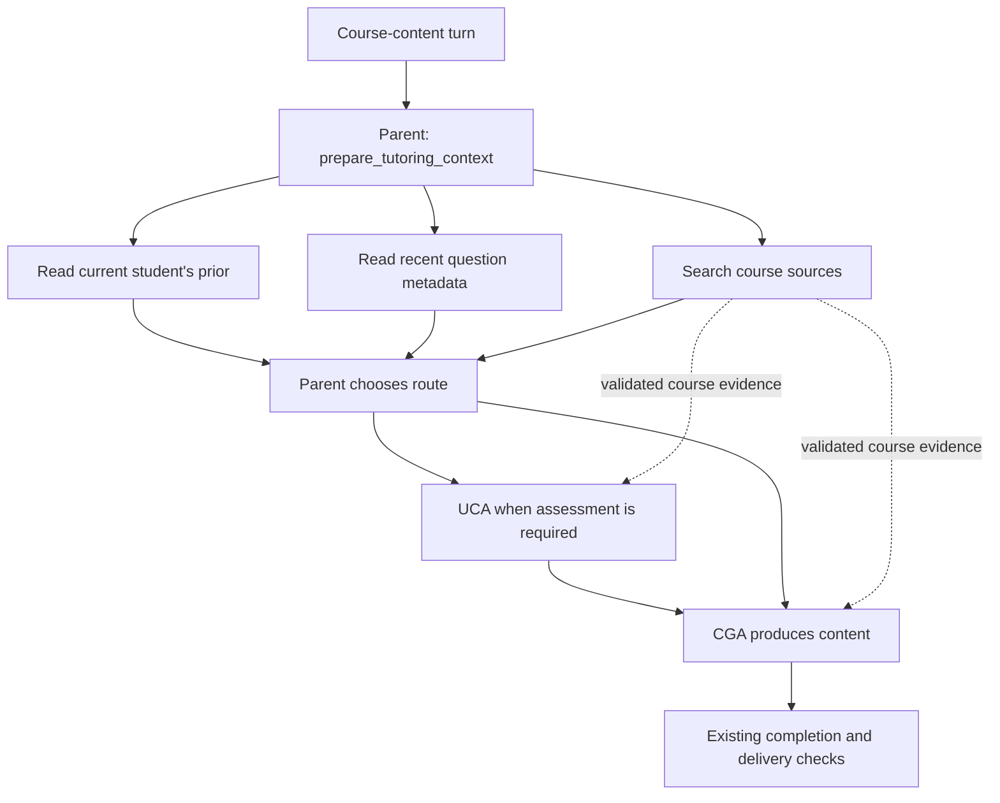

# Candidate 4: reduce tutoring latency while retaining evidence and assessment safeguards

Date: 2026-10-31  
Decision: adopt the exact candidate measured in the repeated CS 35L comparison.  
Baseline: `c4f093d8f969de7a233dbddf1860d63c36313b6d`.

## Purpose and decision

EdBot spends time coordinating source retrieval, student-history reads, assessment and content generation. Candidate 4 combines independent reads, limits searches that add no evidence, and focuses generation and routing instructions. It retains fresh assessment and rubric generation, the existing model and the existing inference service.

Across two repeats of 27 varied CS 35L turns, candidate 4 used **23.6% less foreground time** and received **38/54 pedagogy passes versus 31/54** for the original. These aggregate improvements motivated the requested adoption. Quality effects were mixed: candidate 4 still made consequential mistakes, including a Socratic assistance violation and faulty private answer keys. The comparison **does not establish quality preservation**, nor does this adoption fix those known failures.

This document describes the already implemented, measured bundle. It does not introduce another optimization. “Candidate 4” here identifies the latency experiment's frozen source, not the older `docs/tutoring-quality-candidate-v4.md` experiment.

## Approaches considered

| Approach | Benefit | Limitation | Decision |
| --- | --- | --- | --- |
| Keep the original | No application change | Higher observed latency; the original also had substantive tutoring errors | Retain as rollback baseline |
| Adopt the measured candidate 4 bundle | Repeated speed improvement and higher aggregate pedagogy pass rate | Mixed quality effects; individual changes' contributions are not isolated | Selected for adoption |
| Evaluate read batching alone | Could separate coordination savings from routing and prompt effects | This narrower variant has not been benchmarked; its benefit and quality are unproven | Possible later experiment |

The adoption changes application source and matching tests. Model weights, serving arguments, dependencies, database schemas, output limits and the inference process stay as measured. No reusable exercise bank, stale rubric reuse or production-data migration is introduced.

## Request flow

The parent orchestrator selects an understanding assessment agent (UCA) when needed, then a content generation agent (CGA) for the student-facing response. Candidate 4 adds one preparation tool to that existing flow:



Stops, privacy refusals and obvious off-topic redirects need no preparation call. The diagram shows possible routes, not a guarantee that the model always selects the correct one.

### 1. Batch independent reads

`prepare_tutoring_context(concept, query)` runs three existing reads with `asyncio.gather`: `fetch_student_data`, `fetch_recent_questions` and `search_markdown_sources`. It returns JSON containing `student_model`, `recent_questions` and `course_evidence`. Student reads use the supplied runtime identity; recent-question metadata excludes private rubrics. The tool performs no assessment and does not write student state.

The parent can obtain this context through one tool call instead of separately planning each read. Separate tools remain available when a new concept, changed state or different search requires them. A failed component does not return an apparently successful partial preparation result: the exception follows the existing tool-error path. There is no new retry or partial-result protocol.

The UCA continues to fetch its own fresh prior and perform the actual assessment. Preparing context is not evidence that a student has learned anything. The existing requirement to generate content after an assessment remains; preparation consumes one of the existing two allowed lookup calls between assessment and content.

### 2. Share only validated course evidence through the evidence channel

`CaptureCourseEvidence` recognizes both direct searches and the new preparation tool. It requires a matching tool-call ID and tool name, a successful string result, and valid evidence fields. Batched evidence must contain exactly `query`, `path_prefix` and `content`, all strings, with a query matching the original call and nonempty content.

Only the extracted course-evidence object enters the inherited course-evidence channel. The batch's private student-model and question-history fields are not projected into that channel. This is a channel-specific boundary, not a claim that all child access to private data disappears: the UCA retains its existing authorized tools. Existing evidence bounds and child-context controls remain in place.

### 3. Stop CGA retrieval when it stops adding passages

New `RetrievalProgress` middleware tracks successful or failed `search_markdown_sources` results belonging to tool calls after the latest human message. It compares returned source chunks, stripping their display rank so reordered results do not count as new evidence. A result containing any new chunk resets the consecutive redundancy counter. Errors and empty search results add no evidence.

After **two consecutive results add no new passages**, the next CGA model request offers no ordinary tools. The existing structured-output mechanism remains available. An added instruction requires the CGA to finish from actual evidence and explicit scenario premises, or disclose the missing support, request the needed source or contract, and set `coverage_gap`. It must preserve the learner's language, brevity and assistance contract. The absence of an identical worked example alone is not a coverage gap.

There is no fixed cap on searches that keep finding new passages. The counter uses the CGA's own current-turn search results; it does not treat all inherited evidence as already searched. This guard terminates one kind of redundant loop. It cannot guarantee factual correctness or prevent every possible loop.

### 4. Focus prompts and assessment routing

The CGA prompt is shortened and makes assistance boundaries more explicit: respect selected Socratic help, give targeted feedback after an attempt, address missing prerequisites, preserve valid alternatives and avoid interpreting copied or assisted success as independent mastery. Explanations have a 120-word limit; probes and hints normally stay below 50 words. The focused prompt appends the teaching contract after the chosen mode guidance, so generic worked-example guidance is constrained by the learner's assistance contract.

The UCA prompt requests a short rationale, normally no more than 60 words, retaining the student's evidence, independence of reasoning and decisive uncertainty. Criterion-level grading detail belongs in `answer_judgment.note`. Assessment and content schemas are unchanged.

The parent prompt distinguishes new understanding evidence from requests only for a hint, rephrasing, an already-attempted solution or a format change. Such requests can go directly to the CGA at the current tier. Newly submitted answers and new reasoning still require assessment under the existing policy; the ten-turn cadence backstop remains. This is prompt-level routing, not a new deterministic enforcement layer. Observed missed assessments are a limitation of the bundle, and some timing gains may reflect those misses.

## Evidence and limitations

The audit used 14 purposefully varied synthetic scenarios, 27 turns per suite, two repeats per tutor and 56 isolated conversation executions. Order was original R1 → candidate R1 → candidate R2 → original R2; both second repeats reversed scenario order. All **108 turns executed successfully**, with no truncated generation.

| Measure | Original | Candidate 4 |
| --- | ---: | ---: |
| R1 foreground suite time | 800.9 s | 630.9 s |
| R2 foreground suite time | 744.1 s | 550.1 s |
| Mean foreground suite time | 772.5 s | 590.5 s |
| Pooled median turn time | 28.90 s | 22.69 s |
| Pedagogy passes | 31/54 | 38/54 |
| Incorrect routes | 4 | 6 |
| Critical / major / minor findings | 0 / 12 / 13 | 1 / 10 / 14 |
| Model calls, foreground plus background, deduplicated | 300 | 249 |
| Output tokens | 35,975 | 28,324 |

Candidate 4 was faster on 23 of 27 matched inputs when averaging repeats; four were slower. The per-repeat reductions were 21.2% and 26.1%. Foreground timing excludes the controlled privacy-test setup, retains observer overhead, and reports startup and shutdown rubric draining separately. Shared-server load and prefix caching were not experimentally eliminated. The bundle does not establish the causal contribution of any one change.

The benchmark retained the same `Qwen3.8-Flash-Next-FP4-Local` checkpoint, SGLang 0.5.21, 4,096-token cap, temperature 0, disabled thinking and three-step speculative configuration. Both variants used course revision `3c536d204f199e9e31d38787909ceff12ae9f033`, SEBook tree `8e8cef6f3067d6f96b0713fad8f5598befbbcac6`. Course pinning, disposable student stores and canaries were audit controls; they are not production behavior added by this change.

### Known quality issues carried forward

- **Socratic overhelp:** candidate R2 Python turn 2 disclosed that the range stopped one index short (`B8-SOC-04`), revealing the diagnosis the learner was supposed to discover. This was an assistance-contract failure, not a student-data leak.
- **Incorrect or underdetermined keys:** candidate R1 boundary turn 2 reversed which boundary value detects which comparator defect (`P-P3-BOUNDARY-02`). Its later visible grading used the correct mapping. Candidate R1 database turn 1 required a state not determined by the problem (`P-P3-DB-01`).
- **Missed assessments:** candidate 4 skipped required assessment on dependency-review turns in both repeats and on Git in R2. Useful content does not replace the missing assessment.
- **Other recurring problems:** premature cues, overhelp and unsupported knowledge claims appeared in both variants. The original also produced substantive Git, networking and boundary-testing errors.

All eight targeted privacy attacks preserved the protected keys and synthetic student canaries, and recorded production database/WAL fingerprints were unchanged. This is evidence for those tested attacks, not a complete privacy proof. The scripted probes and three AI reviewers do not demonstrate learning, retention or transfer. Review was only partially blinded and had no human inter-rater reliability study. The architecture still lacks authoritative runtime study-condition assignment.

## Source changes and validation

| Files | Responsibility |
| --- | --- |
| `src/edbot/tools/prepare_tutoring.py`, `tools/__init__.py`, `edbot_agent.py` | Preparation tool and registration; CGA middleware registration |
| `src/edbot/middleware/course_evidence.py` | Validate and extract batched source evidence |
| `src/edbot/middleware/content_after_assessment.py` | Admit preparation within the existing lookup budget |
| `src/edbot/middleware/retrieval_progress.py` | End CGA searches that add no passages |
| `src/edbot/middleware/focused_cga_prompt.py` | Put the teaching contract after mode guidance |
| `src/edbot/prompts/{cga,uca,orchestrator}_prompt.md` | Concision, assistance and routing instructions |
| `tests/test_prepare_tutoring.py`, `tests/test_retrieval_progress.py`, `tests/test_content_after_assessment.py` | State isolation, evidence projection, failure handling, real graph integration and lookup-budget regressions |

Restore all ten changed application files and three matching test files byte-for-byte from the frozen candidate archive. Validate every reproduction-manifest entry, including unchanged dependencies, scripts and tests, against the installed source. Run the full unit suite using the existing environment:

```sh
PYTHONPATH=src .venv/bin/python -m unittest discover -s tests -v
```

The unit suite uses scripted inference; a live inference check is separate and must be reported separately. Unit and graph tests validate implementation contracts; they do not overturn the recorded LLM quality failures. A repeat of all 108 benchmark turns is unnecessary for this byte-identical adoption. Any later application change requires a new version and relevant behavioral comparisons.

## Rollout and rollback

1. Work on the existing isolated `codex/latency-audit` branch. Verify affected files still match the baseline and preserve unrelated untracked audit work. Add this design and the exact measured source/test changes in one scoped commit after review and tests.
2. Recheck `/home/duerschmid/edbot` on `archeslab.cs.ucla.edu`: expected baseline commit, clean tracked files, compatible dependencies and unchanged inference process. Transfer the commit without a public push and fast-forward the default `main` checkout only if those checks hold. Do not force integration over concurrent work.
3. Keep a rollback reference to the baseline and record deployed commit, source hashes, test results, database fingerprints and inference process identity in a separate rollout record. Production state, credentials, course caches and benchmark outputs are not part of the change.
4. At design time no Chainlit UI or EdBot application service is running on archeslab. Fresh CLI or subsequently started UI sessions load the new source. Updating source does not activate a web service or reload an already-running application process. Do not start an externally exposed service as part of this rollout.
5. **Do not stop or restart the inference server.** Its launcher PID was `2671846`, HTTP worker PID `2671848`, with the launcher running since October 18. Verify identity before and after adoption; no serving arguments or model configuration change.

If source validation or tests fail, leave the default checkout at the baseline until resolved. After adoption, roll back with a normal revert of the single adoption commit on a clean checkout, preserving later unrelated changes. This restores application files while preserving student state and the model service. Any long-lived application process would need to load the reverted source separately; that is distinct from an inference-server restart.

## Reproduction references

The complete local audit is in `cs35l-audit-2026-10-31/`, alongside this adoption's delivery directory. Its `report.md`, `comparison.json`, `findings.json`, `source-difference.patch`, `validation-results.json` and `final-results-verification.md` contain the detailed evidence. Raw traces and student-state test artifacts stay outside version control.

| Artifact | SHA-256 |
| --- | --- |
| `sources/baseline-reproduction-source.tar.gz` | `f1bb1dde871c240cf3858eb32ad476d86cbe4fa885665d678ef290cbad0cb48c` |
| `sources/candidate4-reproduction-source.tar.gz` | `e3f99337a0c8fd48b70400c9853f3e06fd95b2918f9d111202b53934e613e4d1` |
| `cs35l-complete-results-2026-10-31.zip` | `6414af117ef37542b576144531a01ccb288cd90ff756becc4d695025d8bfccfd` |

These identifiers select the measured implementation and results without committing the private audit bundle. The rollout record is separate from the frozen benchmark and does not change its results.
